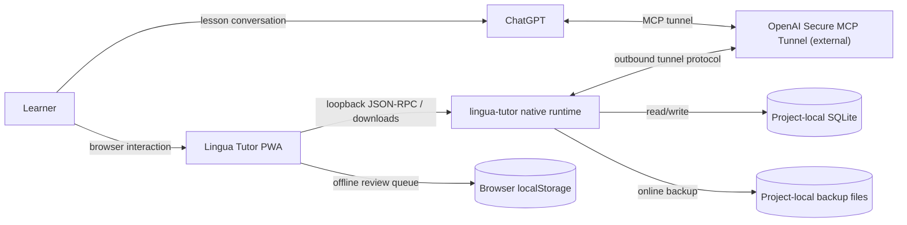
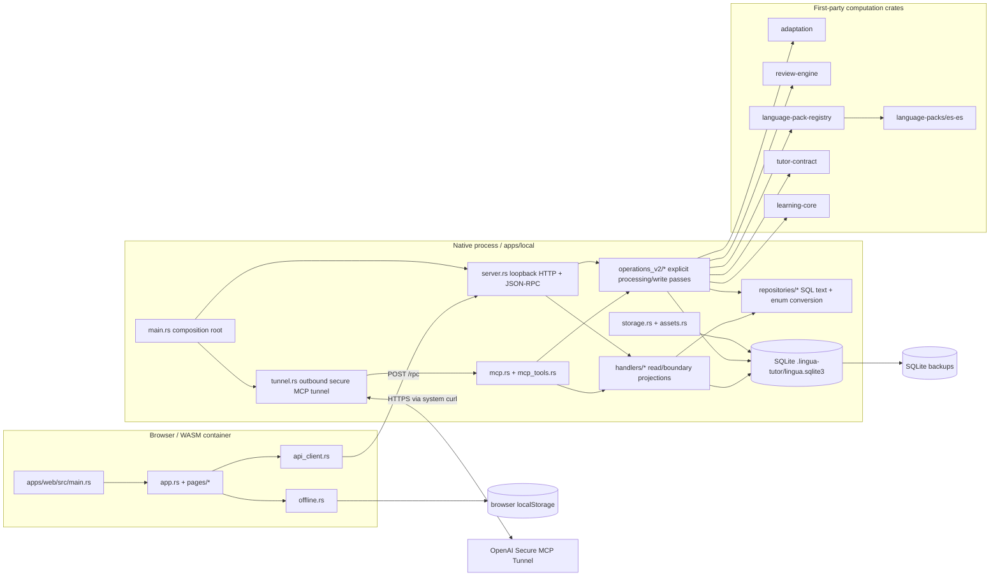
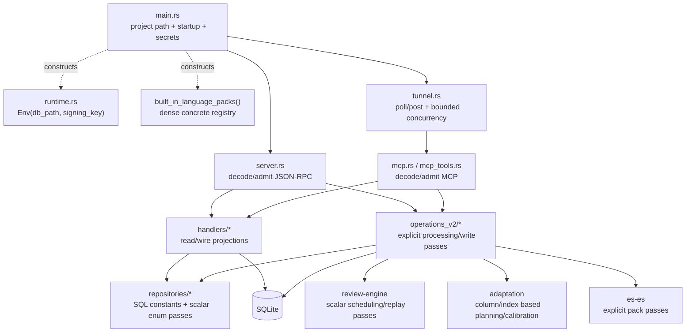
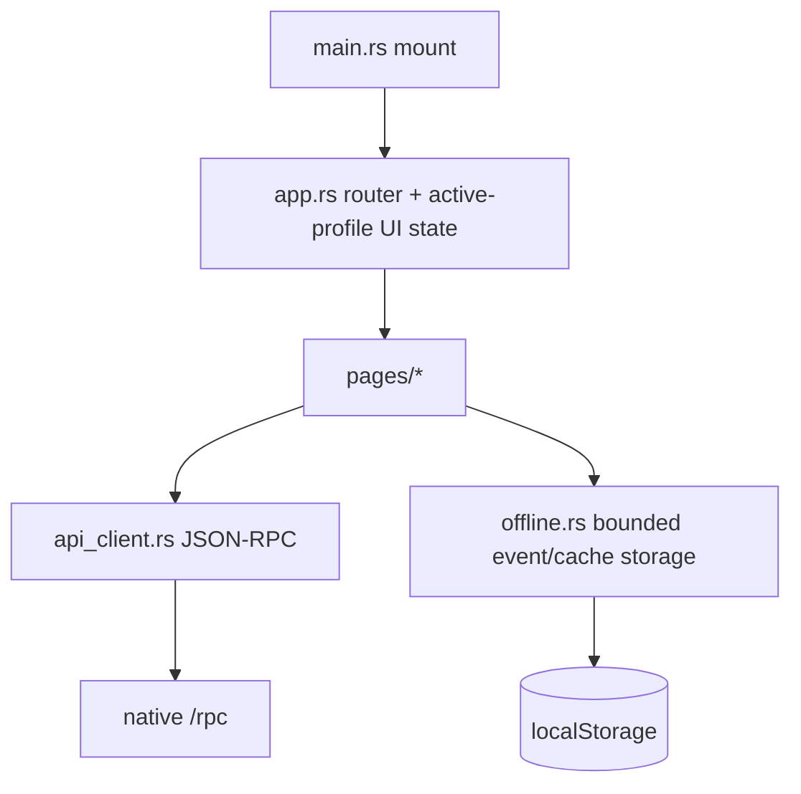

# DOD/PWP preflight — 2026-10-22

Final audit baseline: `refactor/core-data-path`, audited 2026-10-23 before checkpoint commit.
This file is the current as-is review index and acceptance baseline. Older incremental notes that referred to
`apps/local/src/old`, `crates/application`, row-to-domain adapters, or `LanguagePack` trait dispatch are superseded.

## L1 — system context

Trust boundaries:
- browser input and MCP/tunnel input are untrusted protocol boundaries;
- SQLite is the persistent authority for learning state;
- browser localStorage is a bounded offline queue/cache, never scheduling authority;
- tunnel ID/API key are session-only process memory and are not persisted.

## L2 — containers and stores

First-party deployables are the native binary and the browser WASM bundle. `fuzz/` is a separate cargo-fuzz
workspace used only for verification. GitHub Actions builds/tests/releases these artifacts; it is not runtime state.

## L3 — native components and directed flow

Structural observations:
- `apps/local/src/old` and `crates/application` are absent.
- There is one native business-write implementation: `operations_v2`.
- `LanguagePack` behavior trait/dynamic dispatch is absent; production uses a concrete dense registry and explicit pack passes.
- `ReviewScheduler` trait/dynamic dispatch is absent; scheduler selection is explicit integer/scalar dispatch.
- `handlers/*` remains necessary where it directly projects read/wire results; delegation-only write paths have been removed.
- `repositories/*` contains SQL text/scalar mapping used by both reads and passes. Any further merge/removal must be justified per operation rather than by name.
- `Arc` in server/tunnel is process/concurrency resource sharing, not a domain-entity graph. It remains a boundary/concurrency candidate only if a simpler ownership model preserves Tokio task lifetimes.

## L3 — browser components and directed flow

Browser DTOs are wire/UI boundary data. Offline pending review events are bounded to 50 and replay in order.
No browser object is authoritative for persisted scheduling state.

## L4 — repository-closure paths

| Operation/gate | Exact data path | Retained state / multiplicity | Current finding |
| --- | --- | --- | --- |
| JSON-RPC write | wire JSON → `server::dispatch_rpc` → one `operations_v2` pass → SQLite txn | request-local buffers; SQLite authoritative | single implementation |
| MCP write | tunnel raw JSON → `mcp::dispatch_jsonrpc` / `mcp_tools` → same `operations_v2` pass | request-local; same DB authority | single implementation |
| lesson completion | `LessonResult` → preload columns → `LessonPlanState` SoA/index passes → bounded write buffers → SQLite | request-local arrays/text arenas; stable indices | DOD path active |
| review | persisted scalar schedule columns → `review-engine` pass → scalar result → SQLite | no scheduler object graph | DOD path active |
| adaptation | SQLite/context columns → request-local indexed/column buffers → explicit rules | request-local arrays / CSR-like prefix ranges where sparse | DOD path active |
| language behavior | pack ID → dense registry index → concrete es-ES data → free processing functions | immutable startup pack data | no trait dispatch |
| offline replay | bounded `Vec<PendingEvent>` at browser storage boundary → ordered RPC replay | max 50 wire records | boundary DTO, not domain authority |
| strict CI | source + tests → fmt/clippy/test/trunk/deny | no runtime state | local compile/test/lint/build gates pass |
| fuzz supply chain | `fuzz/Cargo.toml + fuzz/Cargo.lock` → cargo-deny | separate workspace | lock/policy pass; both fuzz targets smoke-tested |

## Remaining architecture acceptance work

### A. `learning-core` retained domain records — CLOSED

Repository-wide consumer tracing showed that `Card`, `Lesson`, `LearningItem`, `LearningItemEvidence`,
`ErrorTarget`, `LearnerProfile`, `LearnerLanguageProfile`, entity string-ID wrappers, and
`RecommendationSubject` had no production consumers. `assess_mastery` was likewise only self-tested; the
active lesson pass already evaluates mastery from its bounded evidence columns.

Those records/modules are removed. `learning-core` now owns only the scalar enums/timestamp and pure
error/card hash rules that have real production consumers. An architecture test rejects reintroduction of the
removed entity records, ID module, or AoS mastery module.

### B. Internal identity — CLOSED

SQLite/wire IDs remain strings only at the persistence/protocol boundary. Retained in-process relationships on the audited core path use dense `u32` keys/indices: pack lookup resolves to `PackIndex = u32`; registry sparse relations use flat buffers plus `u32` prefix ends; adaptation uses dense `u32` keys/CSR-style ranges; `LessonPlan` and `CardPlan` retain source/status/entity links as `u32`. Conversion to `usize` occurs only transiently at array/slice access. The former owned string-ID layer in `learning-core` is removed, and architecture tests reject regressions.

### C. Strict all-target lint — CLOSED

`cargo clippy --locked --workspace --all-targets --all-features -- -D warnings` passes. Test-only fail-fast fixture exceptions are scoped to test modules/files with explicit comments; production lint policy remains unchanged.

### D. Supply-chain / fuzz — CLOSED

Root `cargo deny --locked check` passes. The separate fuzz lock is refreshed, declares its own MIT license, and passes the same deny policy including the NCSA license required by `libfuzzer-sys`. The fuzz workflow now runs `cargo-deny@0.20.2` against `fuzz/Cargo.toml` before fuzzing.

### E. Release evidence — PARTIAL / ENVIRONMENT-DEPENDENT

Verified locally on the final working tree: format, workspace check/tests, strict all-target Clippy, WASM target check, Trunk release build, native debug/release builds, root + fuzz cargo-deny, git diff check, and smoke runs for both fuzz targets.

Not executable as green in this Rivet sandbox: Playwright fails before test execution because Node hits `EPERM` resolving `/opt`; a direct release-binary RPC benchmark initializes SQLite/assets but the sandbox denies localhost socket bind; real tunnel→SQLite requires the external tunnel service/credentials; Linux evidence belongs to CI. No performance improvement is claimed until representative RPC latency/profiling runs in a bind-capable environment.

## Acceptance status

**DOD/PWP STRUCTURAL ACCEPTANCE: APPROVED. PRODUCTION RELEASE EVIDENCE: NOT YET COMPLETE.**

The whole-repository structural audit found no remaining object-centric learning-domain layer, virtual language-pack/scheduler dispatch, retained `usize` entity relationships on migrated plans, or duplicate native business implementation. Release remains gated on environment-dependent Playwright, live RPC performance/profiling, external tunnel E2E and CI platform evidence.
