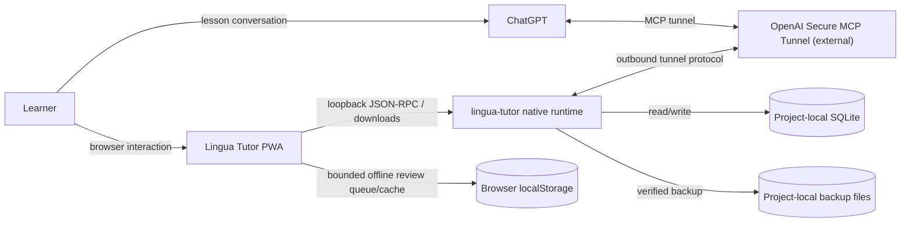
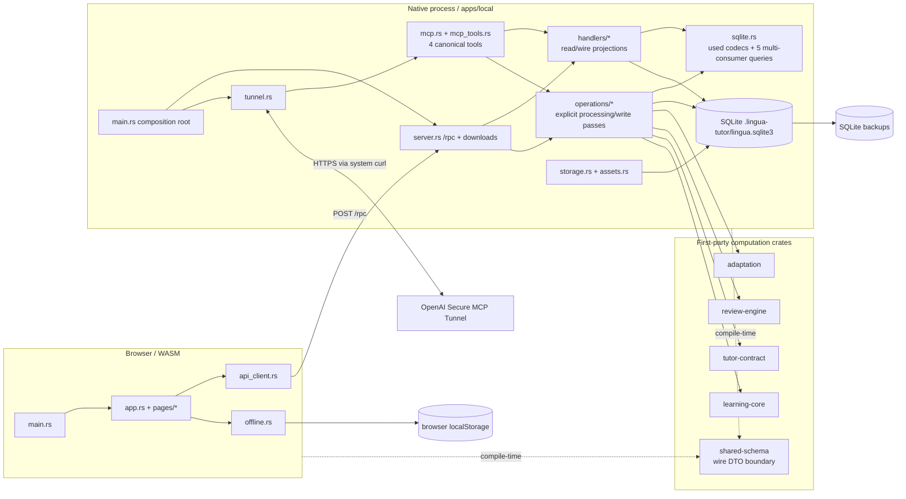
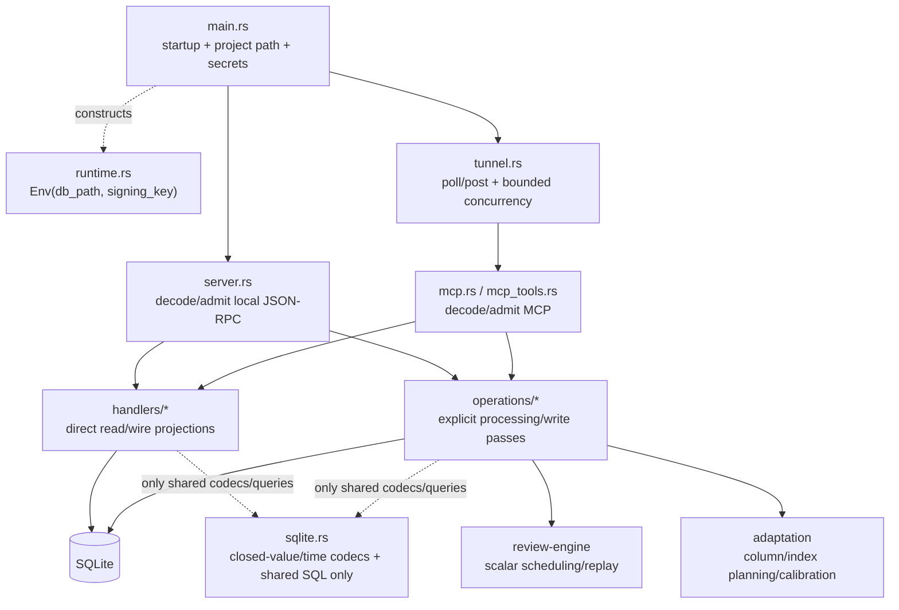
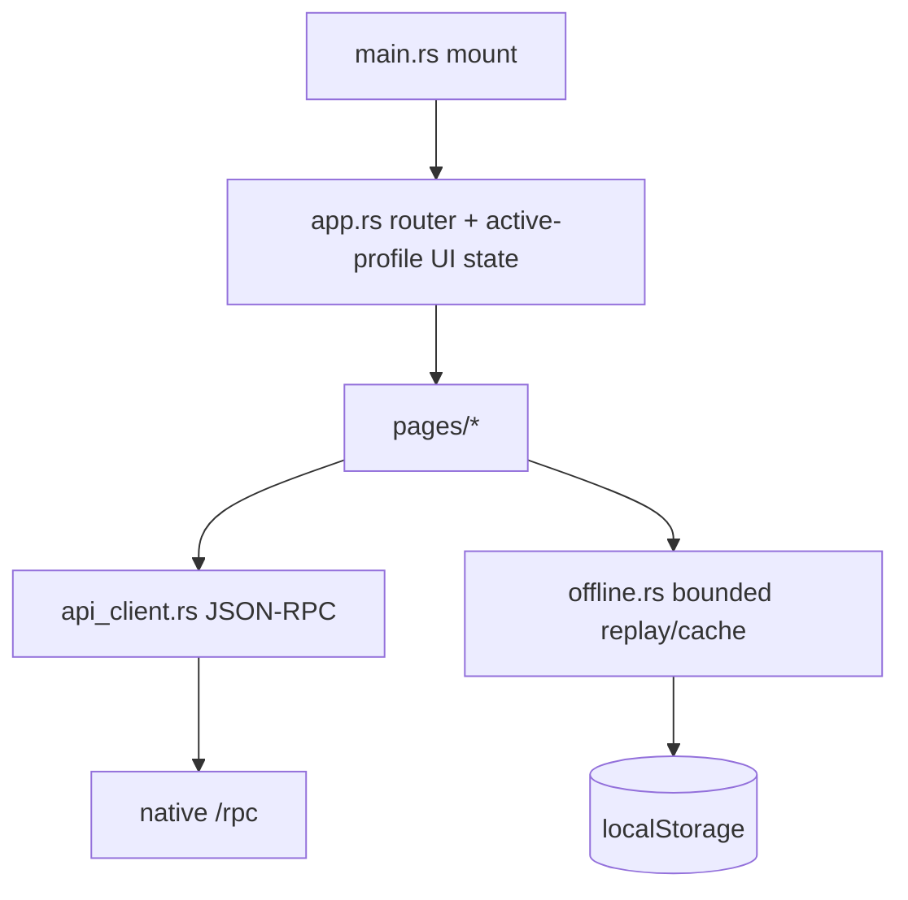

# DOD/PWP preflight — current architecture (2026-11-06)

Current structural baseline: working tree on `audit/repository-cleanup`.
This document is the as-is DOD/PWP review index. Historical release evidence remains in
`docs/dod-release-gate.md`; this file describes the current architecture only.

## L1 — system context

Trust/ownership boundaries:
- browser and MCP/tunnel input are untrusted protocol input;
- SQLite is the sole persistent learning-state authority;
- browser localStorage is bounded non-authoritative replay/cache state;
- tunnel credentials live only in process memory;
- backup files are recovery artifacts, not a second application datastore.

## L2 — deployables, stores, and first-party compute

First-party deployables are the native binary and browser WASM bundle. `fuzz/` and GitHub Actions
are verification infrastructure, not runtime layers.

## L3 — native directed flow

Structural result:
- no generic repository/service/application layer remains;
- `repositories/profiles|lessons|records|cards` SQL bags were removed;
- the remaining review/recommendation shared SQL and scalar DB conversions were collapsed into one
  crate-private `sqlite.rs`;
- single-consumer SQL is colocated with its owning read projection or write/processing pass;
- `handlers/*` are direct projections, not write services;
- business mutation is implemented by explicit `operations/*` passes;
- redundant recommendation operation modules were merged;
- standalone MCP maintenance write subsystems were removed;
- MCP exposes only `get_active_language_profile`, `get_tutor_context`, `start_lesson`,
  and `complete_lesson`;
- narrow inspection operations remain on the browser RPC compatibility surface, not duplicated as MCP tools;
- executable language packs/registry and scheduler/domain-object dispatch are absent;
- `Env`, tunnel/MCP, `shared-schema`, offline replay, and compute crates remain because they carry
  concrete lifetime, protocol, failure-mode, wire-contract, or algorithmic boundaries.

## L3 — browser directed flow

Offline pending events are bounded to 50 and replay in order. Browser state never becomes scheduling
or learning-state authority.

## L4 — operation closure

| Operation | Physical data path | Retained state | Decision |
| --- | --- | --- | --- |
| Browser read | wire request → `server::dispatch_rpc` → direct `handlers` projection → SQLite | request-local rows/columns | KEEP |
| Browser write | wire request → `server::dispatch_rpc` → one explicit `operations` pass → SQLite transaction | request-local buffers | KEEP |
| Tutor read | tunnel → MCP decode → `get_tutor_context` → direct projections/planner passes → SQLite | one authoritative context document | KEEP |
| Tutor lesson write | tunnel → `start_lesson` / `complete_lesson` → plan/apply/write passes → SQLite transaction | bounded SoA/index buffers | KEEP |
| Lesson completion | `LessonResult` → preload → `LessonPlanState` / card plan → bounded writes | dense indices + text arenas | DOD path |
| Review | persisted scalar schedule columns → `review-engine` → scalar result → SQLite | no scheduler object graph | DOD path |
| Adaptation | SQLite/context columns → indexed/column buffers → explicit rules | dense `u32` indices / CSR-style ranges | DOD path |
| Offline replay | bounded `PendingEvent` wire records → ordered RPC replay | max 50 records | boundary-only |
| SQLite sharing | owning pass contains single-consumer SQL; `sqlite.rs` contains only reused codecs/queries | no repository objects | minimal boundary |

## Data-layout and PWP status

SQLite/wire entity IDs remain strings at persistence/protocol boundaries. Retained relationships on the
audited planner/card/lesson/adaptation paths use dense `u32` indices or flat prefix/range layouts;
`usize` conversion is transient at slice access. Application/data paths contain no dynamic domain dispatch,
pointer-linked entity graph, `HashMap`/`BTreeMap` state store, service object, repository object, or manager
hierarchy. `Arc` and `Box<RawValue>` remain only in tunnel/wire infrastructure where concurrency/protocol
ownership requires them.

## Removed as unnecessary

- generic `repositories/` subsystem;
- profile/lesson/record/card SQL-bag modules;
- test-only/unused SQLite enum encode/decode functions;
- `recommendation_ops` split from recommendation writes;
- standalone `upsert_cards`, bulk `suspend_cards`, `log_error_occurrence`, and lesson-correction MCP paths;
- five partial MCP inspection tools duplicated by authoritative `get_tutor_context`;
- integration test API exposure used only to reach internal SQLite codecs.

## Current verification

Passed on this working tree:
- `cargo fmt --all -- --check`;
- `cargo check --workspace --locked`;
- `cargo test --workspace --locked`;
- `cargo clippy --locked --workspace --all-targets --all-features -- -D warnings`;
- `git diff --check`.

The separate fuzz workspace could not be recompiled in this Rivet sandbox because Cargo cannot create its
registry cache (`EPERM`), including with a separate `/tmp` Cargo home. This is an environment failure before
fuzz code compilation, not a green fuzz result. Fuzz compilation remains an external/CI gate.

## Acceptance

**Current structural state: DOD/PWP architecture accepted for the audited paths.**

No additional layer should be introduced unless it has a concrete ownership, correctness, protocol,
failure-mode, or measured performance requirement. Functional correctness alone does not justify
reintroducing removed repository/service/maintenance abstractions.
