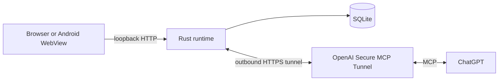

# Local runtime

## Desktop

Run from the directory that owns the learning state:

```sh
mkdir -p ~/spanish
cd ~/spanish
lingua-tutor run
```

On Windows invoke `lingua-tutor.exe`. The runtime creates or reopens:

```text
<workspace>/.lingua-tutor/
├── lingua.sqlite3
├── web/
└── backups/          # created when a backup is written
```

The working directory selects the database. Multiple directories have independent learning state. The runtime writes embedded web assets on startup.

| Command | Behavior |
|---|---|
| `run` | Start loopback HTTP; open browser tunnel setup. |
| `run --port N` | Select the loopback port (default 8787). |
| `run --no-tunnel` | Start UI and RPC without the MCP tunnel. |
| `run --terminal-tunnel` | Enter tunnel credentials with terminal echo disabled. |
| `check` | Validate the existing database and web asset directory. |
| `backup` | Write a verified SQLite snapshot; print its path. |
| `where` | Print workspace, state directory and database paths. |

## Android

Install `lingua-tutor-v<VERSION>-android.apk` from a release containing Android assets. Minimum OS: Android 9 (API 28). Supported ABIs: `arm64-v8a`, `x86_64`. Package ID: `io.linguatutor`.

- Launch **Lingua Tutor**. Android starts the Rust library on a background thread and opens the setup page in WebView.
- Database: `<app-private files>/.lingua-tutor/lingua.sqlite3`. Updates signed with the same certificate retain it. Uninstalling or clearing app data deletes it, including local backups. Android system backup is disabled.
- From releases after v0.1.10, open Languages → Export data. JSON/CSV exports use Android's document picker. v0.1.10 has no navigation link to its export route. Desktop databases are not imported automatically.
- Android can terminate the app process while it is in the background. Reopen the app and reconnect the tunnel if that occurs. There is no foreground service guaranteeing tunnel availability.
- A new process uses a new loopback port. WebView storage is origin-scoped; pending browser-only offline review events are not guaranteed to survive a port change. Committed SQLite records are unaffected.

## Network and credentials



Desktop binds `127.0.0.1:8787` by default. Android binds `127.0.0.1` on an OS-assigned port and requires the app's random session cookie on every HTTP request. Both validate the Host and any Origin header. The runtime has no public listener.

The setup page at `/setup` accepts a Tunnel ID and restricted Runtime API key through a same-origin JSON-RPC request. It opens the dashboard after an authorized initial poll. A failed connection leaves the local UI available. Select **Continue locally** to skip the tunnel.

Credentials remain in process memory; the application does not persist them or pass them in command-line arguments. Desktop terminal mode also accepts them through hidden input.

Desktop HTTPS uses system curl: Linux `/usr/bin/curl` or `/bin/curl`, macOS `/usr/bin/curl`, Windows `%SystemRoot%\System32\curl.exe`. Android uses in-process Rustls with WebPKI roots. Neither requires a separate tunnel client.

The tunnel implements base wire version `2026-08-25`: process-stable instance ID, bounded polling and concurrency, response deadlines, retry backoff with `Retry-After`, shard-token echo and dropping unknown command types. The optional `wrong-cluster-v1` capability is not implemented or advertised.

## Backup and update

On startup with an existing database, the runtime creates a SQLite online backup if no backup was written in the previous 24 hours. It checks integrity and foreign keys before retaining the copy. When writing a backup, it removes matching backup files older than 90 days.

Desktop: run `lingua-tutor backup` before replacing the executable. Android: use the export page to save JSON/CSV outside app-private storage before uninstalling. Exports are not full SQLite backups.

## Build from source

The CI Rust toolchain is 1.98.1. Build the frontend before any release-profile native build:

```sh
rustup target add wasm32-unknown-unknown
cargo install trunk --version 0.21.14 --locked
(cd apps/web && trunk build --release --cargo-profile wasm-release)
cargo install --path apps/local --bin lingua-tutor --locked
```

Release builds reject missing or incomplete generated web assets. Browser WebAssembly is the UI only; SQLite and scheduling run in native Rust.

### Android build

Requirements: JDK 17 or later, Android SDK platform 35, build-tools 35.0.0, NDK 28.2.13676358, and the generated frontend above.

```sh
rustup target add aarch64-linux-android x86_64-linux-android
```

Set the following environment variables: `ANDROID_HOME`, `ANDROID_NDK_HOME`, `ANDROID_SIGNING_KEYSTORE`, `ANDROID_SIGNING_ALIAS`, `ANDROID_SIGNING_STORE_PASSWORD`, `ANDROID_SIGNING_KEY_PASSWORD`. Do not commit secret values.

```sh
bash scripts/build-android.sh
```

Output: `dist-android/lingua-tutor-v<VERSION>-android.apk`. The script builds both native libraries, compiles the Java activity and resources, aligns the package, signs it and verifies its signature and contents.

### Release signing

Run `bash scripts/setup-android-signing.sh` once with an authenticated GitHub CLI to configure the repository secrets:

| Secret | Value |
|---|---|
| `ANDROID_KEYSTORE_BASE64` | Base64-encoded private signing keystore |
| `ANDROID_KEY_ALIAS` | Signing key alias |
| `ANDROID_KEYSTORE_PASSWORD` | Keystore password |
| `ANDROID_KEY_PASSWORD` | Key password |

Keep an offline backup of the signing key and password. CI test APKs use an ephemeral signing certificate and are not upgrade-compatible with release APKs. Only release-signed APKs are intended for persistent installations.
