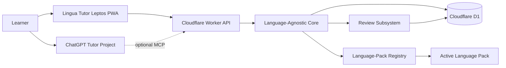

# Lingua Tutor
## Language-Agnostic Learning Platform — Detailed Technical Specification

**Document version:** 2.0  
**Status:** Implementation-ready architecture baseline  
**Date:** 2026-07-12  
**Target repository:** `lingua-tutor`  
**Specification language:** English  
**Initial language pack:** Spanish for Spain (`es-ES`)  
**Primary deployment target:** Cloudflare Workers Free + D1  
**Primary client:** Mobile-first Leptos PWA  
**Primary learning mechanism:** Language-agnostic tutor orchestration, plugin-based language packs, and an integrated review subsystem  

---

## 1. Executive Summary

Lingua Tutor is a language-agnostic personal learning platform. Its reusable core manages lessons, learner evidence, tutor actions, review scheduling, progress analytics, persistence, offline behavior, security, and ChatGPT integration. Target-language behavior is supplied by versioned language-pack plugins.

The initial product configuration ships with a Spanish-for-Spain pack, but Spanish is not embedded into the platform architecture, database schema, API naming, or review engine. Adding another language must not require forking the application or modifying core scheduling logic.

The core product decisions are:

- the spaced-repetition capability is an internal **Review subsystem**, not the product itself;
- the Review subsystem is language-agnostic and schedules validated learning items without understanding Spanish, grammar, or vocabulary;
- language packs are plugins behind a stable versioned contract;
- the tutor creates and maintains cards from lesson evidence using the active language pack;
- the learner is not required to maintain decks manually;
- Anki is not a runtime dependency;
- all language-specific normalization, answer matching, error taxonomies, prompt fragments, phrase templates, locale behavior, and pedagogical metadata belong to a language pack;
- the first implementation uses statically registered build-time plugins, not arbitrary runtime-loaded code.

The selected production architecture is:

- **Frontend:** Leptos client-side rendered PWA compiled to WebAssembly.
- **Backend:** Rust Cloudflare Worker using `workers-rs`.
- **Database:** Cloudflare D1.
- **Core:** language-neutral domain and application services.
- **Review subsystem:** application-owned scheduler, immutable review log, queue management, and workload protection.
- **Plugin subsystem:** versioned language-pack registry and contract.
- **Initial plugin:** `language-pack-es-es`.
- **Infrastructure:** Terraform for resources and policy; Wrangler for application deployment and D1 migrations.
- **Authentication:** Cloudflare Access for the owner-facing application.
- **ChatGPT integration:** optional remote MCP tools with OAuth 2.1, implemented only after compatibility and account-access validation.
- **Fallback integration:** versioned copy/import lesson context when MCP is unavailable.

The system is intentionally not a generic learning-management system, an Anki clone, or a marketplace for untrusted plugins. It implements only the capabilities needed for adaptive tutor-led language acquisition.

## 2. Product Objectives

### 2.1 Primary objective

Enable a learner to communicate in an active target language as quickly as possible, prioritizing:

1. spontaneous speech production;
2. comprehension of common spoken language;
3. automatic recall of high-value phrases and constructions;
4. correction of recurring errors;
5. transfer of learned material into new contexts;
6. low-friction daily practice;
7. reusable core behavior across all supported language packs.

The initial product objective is rapid practical Spanish acquisition for a Russian-speaking learner living in Spain. That is configuration supplied by `language-pack-es-es` and the learner profile, not a core-platform assumption.

### 2.2 Product outcomes

The application must make it possible to answer these questions at any time:

- What lesson should happen next?
- Which cards are due today?
- Which learning items can the learner produce without help?
- Which learning items are recognized only in text or audio?
- Which learning items fail in spontaneous conversation despite successful reviews?
- Which errors keep recurring?
- Which cards should the tutor create, rewrite, split, merge, suspend, or retire?
- Is the review workload becoming excessive?
- Is listening comprehension improving?
- Is active speaking time increasing?
- Which targets require a changed teaching method?

### 2.3 Success indicators

The system must track, at minimum:

- lessons completed;
- active speaking minutes;
- new phrases introduced;
- cards created by the tutor;
- cards modified, split, merged, suspended, or retired;
- reviews completed;
- due and overdue reviews;
- review time;
- recall grade distribution;
- estimated retention;
- learning items recalled without help;
- learning items transferred to a new scenario;
- listening-comprehension score;
- response latency and long pauses;
- repeated errors by category;
- error recovery after 1, 3, and 7 days;
- review backlog;
- weekly consistency.

---

## 3. Design Principles and Hard Constraints

### 3.1 Tutor-managed learning content

The tutor is the primary author and maintainer of cards.

The learner must not be required to:

- manually create cards after lessons;
- decide which phrases deserve cards;
- copy lesson phrases into a separate tool;
- maintain tags or scheduling fields;
- identify duplicate cards;
- manually redesign ineffective cards.

The learner may edit, suspend, restore, or delete cards through the UI, but those actions are optional controls rather than a normal workflow.

### 3.2 Phrase-first learning

The primary vocabulary unit is a useful phrase, sentence frame, or communicative pattern.

Isolated words are allowed only when:

- the word is independently useful;
- the word is repeatedly missing inside several phrases;
- the word has high practical value;
- a phrase-based card would introduce unnecessary complexity.

### 3.3 Simplicity

The initial production topology must contain:

1. one web/API Worker deployment;
2. one D1 database;
3. one private GitHub repository.

The project must not introduce:

- Anki Desktop;
- AnkiConnect;
- a local synchronization bridge;
- Kubernetes;
- service meshes;
- message brokers;
- event-streaming platforms;
- multiple databases;
- microservices;
- arbitrary runtime loading of untrusted plugin code;
- an interpreted generic rules engine;
- a generic workflow engine;
- a separate backend language without a documented necessity.

### 3.4 Rust-first, not Rust-at-any-cost

The production application, domain logic, scheduler adapter, backend, shared schemas, and frontend should be written in Rust.

A small amount of JavaScript is permitted only for:

- loading the Leptos WebAssembly bundle;
- the PWA service worker;
- an isolated chart adapter if native SVG charts are insufficient;
- a temporary MCP compatibility adapter only when the official integration cannot be implemented reliably in Rust.

### 3.5 Application-owned learning state

Lingua Tutor core is the source of truth for:

- card content;
- card status;
- review history;
- scheduling state;
- learning-item evidence;
- lesson history;
- error history;
- tutor actions;
- recommendations.

A third-party flashcard system must not be required to reconstruct the current state.

### 3.6 No direct model access to the database

ChatGPT must never receive:

- direct SQL access;
- a D1 credential;
- arbitrary database-query capability;
- the complete database by default;
- application secrets.

ChatGPT integration must expose only narrow tools with validated inputs and bounded outputs.

### 3.7 No hidden AI API dependency

The application itself must not require the OpenAI API to function.

Lessons are conducted in a ChatGPT tutor project configured for the active language pack. Lingua Tutor stores state and executes deterministic scheduling and adaptation rules. The review subsystem and installed language packs must remain usable when ChatGPT or MCP is unavailable.

### 3.8 Free-tier compatibility

Normal personal use must fit within Cloudflare Workers and D1 free-tier constraints.

### 3.9 No raw audio storage in MVP

MVP stores listening metrics, text, timestamps, and source references. It must not upload or retain full voice recordings.

### 3.10 Language-agnostic core

Core crates, database primitives, API resources, review scheduling, analytics, lesson state, and tutor mutation workflows must not contain language-specific names such as `target_text`, `target_locale`, or `es_es`.

Core operates on generic concepts:

- source language;
- target language;
- language-pack identifier;
- target-language content;
- learner-facing prompt;
- evidence;
- error category;
- card intent;
- review state.

### 3.11 Language packs are plugins

A language pack is a versioned plugin that supplies target-language behavior through a stable contract. Version 1 uses plugins registered at build time and selected at runtime by identifier.

A pack may provide data assets and Rust behavior, but it must not:

- access D1 directly;
- perform network calls;
- read secrets;
- bypass core validation;
- own scheduling state;
- write review events directly;
- define arbitrary executable workflows.

### 3.12 Subsystem boundaries

The Review engine, Tutor orchestration, Analytics, Language-pack registry, Persistence, and Offline sync are separate subsystems inside one deployable application. A subsystem boundary is a code ownership and dependency boundary, not a separate service or deployment.

---

## 4. Scope

### 4.1 In scope for production version 1

- mobile-first dashboard;
- lesson history;
- lesson start and completion records;
- learning-item inventory;
- tutor-generated cards;
- card editing and lifecycle management;
- integrated review sessions;
- deterministic spaced-repetition scheduling;
- immutable review history;
- active-recall status;
- listening attempts;
- speaking metrics;
- error occurrence tracking;
- 1/3/7-day error rechecks;
- automatic escalation of repeated errors;
- adaptive learning recommendations;
- PWA installation;
- bounded offline review support;
- JSON and CSV export;
- Cloudflare deployment;
- Terraform infrastructure;
- GitHub Actions CI/CD;
- optional MCP tool layer;
- fallback lesson-context copy/import flow.

### 4.2 Explicitly out of scope for version 1

- full Anki compatibility;
- Anki collection synchronization;
- APKG import or export;
- arbitrary third-party deck import;
- speech recognition;
- automated pronunciation scoring;
- audio-file hosting;
- multi-user accounts;
- public language-pack marketplace;
- runtime execution of third-party plugin binaries;
- public registration;
- subscriptions;
- classrooms;
- social features;
- public deck sharing;
- gamification economy;
- tutor-generated video;
- autonomous lesson delivery without a user-initiated conversation.

---

## 5. System Context



### 5.1 Trust boundaries

1. **Browser boundary:** untrusted client; no server secrets may be embedded in WASM.
2. **Cloudflare boundary:** Worker validates identity, authorization, schemas, idempotency, and rate limits.
3. **Database boundary:** D1 is accessible only through Worker bindings and controlled deployment tooling.
4. **Review boundary:** scheduling inputs and outputs are validated and versioned; the Review subsystem has no direct network access and no language-specific behavior.
5. **Plugin boundary:** language packs receive only bounded typed inputs and cannot access D1, secrets, or network APIs directly.
6. **ChatGPT boundary:** MCP outputs contain only the minimum required learner and active-pack context.
7. **GitHub boundary:** repository contains code, pack assets, and schema, never production secrets or database exports.

## 6. Architecture Decisions

### 6.1 Frontend rendering mode

Use **Leptos CSR** for the initial deployment.

Rationale:

- the application is private and does not require SEO;
- Cloudflare can serve static assets efficiently;
- CSR avoids forcing conventional server semantics into an edge runtime;
- the backend remains a small Worker API;
- PWA and offline review are straightforward;
- the domain model and API remain compatible with a later SSR migration.

### 6.2 Backend framework

Use Cloudflare `workers-rs` directly.

Do not deploy a conventional always-running Axum server to Workers. Axum may be used in local test utilities only.

### 6.3 Database

Use one D1 database per environment:

- `lingua-tutor-dev`;
- `lingua-tutor-prod`.

Production data must never be used as test fixtures.

### 6.4 API style

Use typed HTTP JSON endpoints for:

- PWA communication;
- fallback import and export;
- future MCP tool handlers.

Command endpoints are acceptable where they map cleanly to domain actions such as completing a review or applying tutor card mutations.

### 6.5 Integrated scheduler

The scheduling engine must be behind an application-owned interface:

```rust
pub trait ReviewScheduler {
    fn initial_state(&self, input: InitialReviewInput) -> Result<ScheduledState, ScheduleError>;

    fn apply_review(
        &self,
        current: &ScheduledState,
        event: &ReviewEventInput,
        settings: &SchedulerSettings,
    ) -> Result<ScheduledState, ScheduleError>;

    fn predicted_retrievability(
        &self,
        state: &ScheduledState,
        at: Timestamp,
    ) -> Result<f64, ScheduleError>;
}
```

The application owns the interface and persisted schema. A third-party algorithm crate is an implementation detail, not an external service dependency.

The initial algorithm should be FSRS-compatible because it models difficulty, stability, and retrievability and supports adaptive scheduling. The implementation must be pinned and verified for Worker compatibility before adoption.

If the selected Rust crate cannot compile reliably for the Worker target or adds unreasonable binary size, the project must:

1. keep the scheduler interface;
2. use a small deterministic fallback scheduler;
3. preserve immutable review data;
4. defer parameter optimization;
5. avoid blocking the rest of the application.

### 6.6 MCP architecture

MCP is an optional interface over the same application service layer used by HTTP endpoints. It must not own business logic or duplicate database queries.

MCP remains feature-gated until account availability, OAuth, transport, write confirmation, mobile behavior, and latency are validated.

### 6.7 Authentication

| Client | Authentication |
|---|---|
| Browser/PWA | Cloudflare Access restricted to the owner email |
| MCP/ChatGPT | OAuth 2.1 authorization code flow with PKCE, if enabled |
| CI/CD | scoped Cloudflare API token stored in GitHub environment secrets |

### 6.8 Optional interoperability

Version 1 must support versioned JSON and CSV export.

Direct Anki synchronization is not part of the core architecture. A later adapter may be added only if real usage demonstrates a need. It must consume exported records and must not become the system of record.

### 6.9 Plugin registration model

Version 1 uses compile-time plugin registration with runtime selection:

```rust
pub fn built_in_language_packs() -> LanguagePackRegistry {
    LanguagePackRegistry::new([
        language_pack_es_es::register(),
    ])
}
```

This provides a real plugin contract without introducing dynamic libraries, remote code loading, plugin sandboxing, or a package marketplace. A later release may load signed declarative pack assets at runtime, but executable pack behavior remains compiled and reviewed unless a separate security design is approved.

---

## 7. Core and Language-Pack Plugin Architecture

### 7.1 Naming model

The platform uses the following naming conventions:

| Concept | Required name |
|---|---|
| Product | Lingua Tutor |
| Repository | `lingua-tutor` |
| Reusable platform logic | `learning-core` |
| Spaced-repetition capability | `review-engine` subsystem |
| Tutor-facing contracts | `tutor-contract` |
| Plugin registry | `language-pack-registry` |
| Spanish for Spain plugin | `language-pack-es-es` |
| Future example plugin | `language-pack-en-gb` |

Do not use `Spanish`, `Anki`, or a specific locale in generic crate, table, endpoint, or domain-type names.

### 7.2 Core responsibilities

The core owns:

- learner profiles and goals;
- active language-pack selection;
- lesson lifecycle;
- tutor-context assembly;
- tutor result validation;
- phrase and learning-item lifecycle;
- evidence and error history;
- card mutation workflow;
- Review subsystem orchestration;
- scheduling persistence;
- analytics and progress calculation;
- offline event reconciliation;
- authentication and authorization;
- imports, exports, API, and MCP boundaries.

The core must not decide language-specific correctness, naturalness, morphology, punctuation tolerance, or error classification when those decisions require target-language knowledge.

### 7.3 Review subsystem responsibilities

The Review subsystem is a reusable language-neutral subsystem inside core. It owns:

- card scheduling states;
- `Again`, `Hard`, `Good`, and `Easy` review semantics;
- due-queue construction;
- backlog protection;
- review session state;
- immutable review events;
- scheduler algorithm versioning;
- retrievability and workload calculations;
- scheduler parameter sets;
- undo and idempotent offline replay.

It consumes validated cards and review events. It does not create cards, translate text, classify grammar, normalize language, or know which language is active.

### 7.4 Language-pack responsibilities

A language pack owns all target-language-specific behavior and assets, including:

- BCP 47 locale metadata and regional variant;
- supported learner/source languages;
- text normalization and canonical comparison;
- punctuation, capitalization, diacritic, and contraction policies;
- accepted-answer matching rules;
- tokenization or morphology helpers when required;
- language-specific error taxonomy and mappings to core error categories;
- phrase, collocation, and sentence-frame seed assets;
- card-generation templates;
- tutor prompt fragments and correction conventions;
- pronunciation and transcription conventions;
- communicative scenarios and cultural/pragmatic notes;
- CEFR or equivalent level descriptors;
- locale-specific UI labels only when they are content rather than application chrome.

### 7.5 Language-pack contract

The exact types may evolve during implementation, but the contract must preserve this responsibility split:

```rust
pub trait LanguagePack: Send + Sync {
    fn manifest(&self) -> &LanguagePackManifest;

    fn normalize_target_text(
        &self,
        input: &str,
        mode: NormalizationMode,
    ) -> NormalizedText;

    fn evaluate_answer(
        &self,
        request: &AnswerEvaluationRequest,
    ) -> AnswerEvaluation;

    fn classify_error(
        &self,
        request: &LanguageErrorClassificationRequest,
    ) -> LanguageErrorClassification;

    fn card_templates(&self) -> &[CardTemplate];

    fn tutor_instructions(
        &self,
        learner: &LearnerLanguageProfile,
    ) -> TutorInstructionBundle;

    fn curriculum_catalog(&self) -> &CurriculumCatalog;
}
```

The core owns all request and response types. A pack cannot expose implementation-specific types across the boundary.

### 7.6 Language-pack manifest

Each plugin must expose a manifest with at least:

```json
{
  "id": "es-ES",
  "package": "language-pack-es-es",
  "version": "1.0.0",
  "contract_version": "1",
  "target_language": "es",
  "target_locale": "es-ES",
  "display_name": "Spanish (Spain)",
  "supported_source_languages": ["ru", "en"],
  "default_source_language": "ru",
  "level_framework": "CEFR",
  "capabilities": [
    "production_cards",
    "listening_cards",
    "contrast_cards",
    "transfer_cards",
    "error_classification",
    "answer_matching"
  ]
}
```

### 7.7 Plugin lifecycle and compatibility

- Pack IDs are stable.
- Pack versions follow semantic versioning.
- The core contract has its own integer compatibility version.
- Startup fails clearly when an enabled pack is incompatible.
- Pack upgrades must include migration notes for changed content identifiers or taxonomies.
- Historical lessons and cards retain the pack ID and pack version that produced them.
- Changing the active pack must not rewrite historical records.
- Core tests run against a synthetic test pack so generic behavior is not accidentally coupled to Spanish.

### 7.8 Initial Spanish pack

`language-pack-es-es` is the first plugin and contains the current Spanish-specific behavior:

- contemporary Spanish used in Spain;
- Russian as the default learner-facing source language;
- Spanish phrase normalization;
- accepted regional alternatives where appropriate;
- Spanish error categories and correction guidance;
- practical scenarios for life in Spain;
- card templates optimized for production, listening, contrast, and transfer.

No Spanish-specific code may be moved back into generic core crates for convenience.

### 7.9 Non-goals for version 1

Version 1 does not implement:

- downloading executable plugins from the internet;
- running untrusted WebAssembly plugins;
- a public plugin marketplace;
- user-authored executable plugins;
- independent deployment of packs;
- per-pack databases;
- pack-owned scheduling algorithms.

---

## 8. Tutor Card Generation Model

### 8.1 Tutor responsibility

At the end of every lesson, the tutor evaluates evidence and returns card mutations as part of the lesson result.

The tutor may:

- create a card;
- update a card;
- add or remove accepted answers;
- add a listening variant;
- split one overloaded card into smaller cards;
- merge semantic duplicates;
- suspend an ineffective card;
- restore a redesigned card;
- retire a mastered low-value card;
- link a card to a phrase, error target, listening item, or scenario.

### 8.2 Evidence sources

Cards may be generated from:

- a new high-value phrase introduced in the lesson;
- a phrase the learner failed to retrieve;
- a recurring error;
- a phrase recognized in text but missed in audio;
- a phrase understood but not produced;
- a phrase produced only with a hint;
- a practical scenario the learner expects to face;
- a useful correction that should replace an unnatural expression;
- a phrase successfully learned but requiring transfer to another context.

### 8.3 Card candidate scoring

The tutor should prioritize candidates using these factors:

- real-life utility;
- frequency in expected situations;
- recurrence of failure;
- communicative impact;
- transfer value across contexts;
- current learning priority;
- novelty;
- overlap with existing cards;
- cognitive load;
- review backlog.

The application may store a tutor-provided `priority_score`, but deterministic rules control activation limits.

### 8.4 Card quality rules

Every card must:

- test one primary recall target;
- have an answerable and unambiguous prompt;
- prefer a situational prompt over a literal translation;
- use the active language pack’s naturalness and regional-variant rules;
- include accepted alternatives when several answers are genuinely valid;
- avoid introducing several unrelated unknown elements;
- include enough context to select the intended register;
- record why the card exists;
- link to source evidence;
- avoid duplicate testing of the same skill unless evidence justifies another modality;
- contain plain text or strictly sanitized markup.

A card must not be created merely because a phrase appeared in a lesson.

### 8.5 Default card mix

The initial recommendation is:

- approximately 60–75% production cards;
- approximately 15–25% listening cards;
- approximately 10–20% contrast or correction cards.

These are guidance ranges, not hard quotas. Actual evidence overrides the mix.

### 8.6 Activation budget

The tutor may propose any number of card candidates, but the application activates no more than the current daily new-card budget.

Default budget:

```text
8 new cards per day
```

When backlog or review time exceeds configured limits, additional cards remain in `candidate` state.

### 8.7 Tutor-generated card mutation schema

```json
{
  "operation": "create",
  "client_operation_id": "op_...",
  "card": {
    "intent": "production",
    "prompt": "You need to ask whether there is an appointment available this week.",
    "answer": "¿Hay alguna cita disponible para esta semana?",
    "accepted_answers": [
      "¿Hay alguna cita libre para esta semana?"
    ],
    "prompt_language": "ru",
    "explanation": "Use hay alguna + noun + disponible/libre.",
    "scenario_tags": ["medical", "appointment"],
    "skill_tags": ["question", "availability"],
    "source_learning_item_id": "phr_...",
    "source_error_target_id": null,
    "creation_reason": "Failed unaided production twice",
    "priority_score": 0.91
  }
}
```

The learner-facing prompt language comes from the learner language profile. The initial `es-ES` profile defaults to Russian.

### 8.8 Duplicate prevention

Before creating a card, the application must compare:

- normalized answer;
- intended communicative function;
- intent type;
- linked phrase;
- linked error target;
- active accepted answers.

Exact retries must be idempotent. Near-duplicates should become a tutor warning or merge recommendation, not an automatic duplicate.

### 8.9 Semantic edits

Edits are classified as:

- **cosmetic:** punctuation, typo, formatting; preserve schedule;
- **clarifying:** improved prompt without changing the tested answer; preserve schedule and record version;
- **semantic:** changed recall target or answer meaning; create a new card or reset learning state after explicit tutor action;
- **split:** suspend original card and create smaller cards with lineage;
- **merge:** preserve source histories, choose one surviving card, and record lineage.

---

## 9. Card Types

### 9.1 Production card

Purpose: retrieve and say a useful target-language phrase from a real situation.

Front:

- Russian or situational prompt;
- optional context;
- optional first-word hint, hidden by default.

Back:

- preferred target-language answer;
- accepted alternatives;
- short explanation;
- pronunciation note where useful.

### 9.2 Listening card

Purpose: recognize a phrase in natural speech and produce a response.

Front:

- audio reference or tutor-provided spoken prompt;
- no transcript initially.

Back:

- transcript;
- meaning;
- expected response;
- pronunciation or linking note.

MVP may use browser speech or tutor audio during a lesson without storing audio files. The card stores a source reference and text.

### 9.3 Contrast or correction card

Purpose: replace a recurring incorrect pattern with a correct one.

Front:

- situation;
- learner's typical incorrect form when useful;
- request to produce the corrected form.

Back:

- correct form;
- one-sentence rule;
- two short contrast examples.

### 9.4 Transfer card

Purpose: prove that a known phrase can be adapted to a new scenario.

Transfer cards should be used sparingly. They must not multiply trivial variations that the learner can already generate productively.

### 9.5 Card intent separation

Recognition and production are different skills. One phrase may have more than one card only when evidence shows a modality gap.

Examples:

- text recognition succeeds but listening fails;
- listening succeeds but production fails;
- prompted production succeeds but spontaneous transfer fails.

---

## 10. Review Engine Requirements

### 10.1 Card states

```text
candidate
new
learning
review
relearning
suspended
retired
```

`candidate` cards are tutor proposals not yet introduced because of budget, duplication, or missing quality validation.

### 10.2 Review grades

The UI supports four grades:

```text
Again
Hard
Good
Easy
```

Semantics:

- **Again:** answer was not recalled correctly before reveal.
- **Hard:** answer was correct, but required substantial effort, hesitation, or a minor self-correction.
- **Good:** answer was correct with normal effort.
- **Easy:** answer was immediate, confident, and fully correct.

The UI must explicitly state that `Hard` is a passing grade and must not be used after forgetting.

### 10.3 Learning flow

A new card enters this sequence:

1. tutor introduces the phrase in a lesson;
2. learner performs immediate retrieval in the lesson;
3. card becomes due in the second daily session or next practical review window;
4. after the first delayed successful recall, the scheduler controls subsequent due dates;
5. a failed review enters `relearning`.

This keeps short-term practice simple and avoids implementing a large configurable learning-step subsystem.

### 10.4 Scheduler settings

Initial defaults:

- desired retention: `0.90`;
- maximum new cards per day: `8`;
- target review duration: `8–12 minutes per day`;
- maximum review batch: configurable, default `50`;
- maximum interval: configurable, conservative default of several years;
- timezone: Europe/Madrid unless changed by the owner.

Higher desired retention creates more frequent reviews, so the application must expose workload consequences rather than encouraging arbitrary increases.

### 10.5 Scheduling state

Persist, at minimum:

- algorithm identifier;
- algorithm version;
- parameter-set identifier;
- card state;
- difficulty;
- stability;
- last review timestamp;
- due timestamp;
- scheduled interval;
- lapse count;
- review count;
- retrievability snapshot when calculated.

### 10.6 Immutable review events

Every submitted grade creates an immutable event containing:

- event ID;
- card ID;
- review session ID;
- presented timestamp;
- answered timestamp;
- grade;
- response duration;
- answer revealed flag;
- optional learner note;
- prior schedule-state hash;
- resulting schedule-state hash;
- algorithm version;
- client operation ID;
- source: online or offline.

Review events must never be overwritten. Corrections create compensating audit records and a recalculated state.

### 10.7 Due queue ordering

Default priority:

1. relearning cards;
2. significantly overdue review cards;
3. due review cards ordered by predicted forgetting risk;
4. due same-day learning cards;
5. new cards within the current budget.

The queue must avoid showing several near-duplicate cards consecutively when practical.

### 10.8 Backlog protection

Default rules:

- if daily review time exceeds 12 minutes for two consecutive study days, reduce new-card budget;
- if overdue cards exceed a configured threshold, pause new cards;
- if active recall falls below 70% for two consecutive study days, reduce new cards by 50%;
- when backlog clears, increase new cards gradually rather than immediately restoring the maximum.

### 10.9 Ineffective-card detection

A card becomes a redesign candidate when any condition is met:

- repeated `Again` results within a rolling window;
- unusually high response time with frequent `Hard`;
- repeated failure despite successful related cards;
- ambiguous prompt reported by the learner;
- conflict with another card;
- successful reviews but repeated conversational failure.

The system should recommend one of:

- clarify prompt;
- add context;
- add accepted answer;
- split card;
- switch modality;
- add contrast;
- suspend temporarily;
- replace card with role-play practice.

### 10.10 Parameter optimization

The initial release uses reviewed default parameters.

Personal parameter optimization is optional and must not run until there is enough reliable review history. The implementation must:

- define a documented minimum sample threshold;
- ignore invalid or corrected events;
- run optimization outside latency-sensitive request paths;
- retain the previous parameter set;
- provide a dry-run comparison;
- avoid mass rescheduling by default;
- support rollback.

The first release may omit optimization entirely while preserving the data required to add it later.

---

## 11. Adaptive Learning Rules

### 11.1 Core rules

- failed production review: include the phrase in the next speaking session;
- successful card review but spontaneous speaking failure: schedule role-play transfer, not merely more card reviews;
- repeated listening failure for a known phrase: create or activate a listening card;
- repeated prompted success but spontaneous failure: create a transfer target;
- error occurrence count reaches three: activate a mini-target and create a contrast card when appropriate;
- unresolved error occurrence count reaches five: require a method change;
- successful use in three distinct contexts: phrase becomes eligible for provisional mastery;
- failed 1/3/7-day recheck: return target to active practice;
- persistent `Hard` grades: redesign before increasing repetition frequency;
- high review success with low real-life utility: consider retiring the card.

### 11.2 Recommendations, not silent content mutation

Deterministic rules generate recommendations.

Tutor card mutations may be applied automatically only when:

- the operation is non-destructive;
- the lesson completion is explicitly submitted by the tutor;
- schema and quality rules pass;
- daily activation limits are respected;
- no duplicate conflict is detected.

Suspension, merge, semantic reset, and retirement must remain visible in the lesson-result preview or MCP write confirmation.

### 11.3 Rule implementation

Rules must be explicit Rust code with unit tests. Do not implement an arbitrary interpreted rule language.

---

## 12. Functional Requirements

### 12.1 Learner and language profiles

The global learner profile contains:

- timezone;
- daily target sessions;
- target session duration;
- maximum new cards per day;
- desired retention;
- maximum review minutes.

Each learner language profile contains:

- active language-pack ID and version;
- source language;
- target locale;
- estimated level;
- language-specific priorities and preferences;
- current lesson number;
- active, paused, or archived status.

Progress, lessons, errors, learning items, cards, and review queues are always scoped to a learner language profile.

### 12.2 Dashboard

The dashboard displays:

- sessions completed today;
- active speaking minutes;
- reviews due and completed;
- estimated review time;
- new-card budget;
- error rechecks due;
- current lesson target;
- current recurring-error targets;
- 7-day and 30-day trends;
- actionable exceptions.

### 12.3 Lesson completion

Completing a lesson accepts atomically:

- metrics;
- new phrases;
- learning-item evidence;
- error occurrences;
- listening attempts;
- mastery changes;
- next target;
- tutor summary;
- card mutations.

The operation must be idempotent through a client-generated operation ID.

### 12.4 Learning-item mastery

A phrase must not become mastered solely because its card was reviewed successfully.

- provisional mastery requires unaided production;
- full mastery requires correct use in at least three distinct contexts or an equivalent configured rule.

### 12.5 Review session

The application must support:

- start review session;
- fetch bounded review queue;
- reveal answer;
- submit grade;
- undo the immediately previous grade through a compensating event;
- finish session;
- resume after temporary network loss;
- prevent duplicate event submission.

### 12.6 Export

The user may export:

- complete versioned learning data;
- compact tutor context;
- Markdown summary;
- cards;
- review history;
- error history;
- lesson history;
- CSV card export.

---

## 13. Core User Workflows

### 13.1 Start a lesson without MCP

1. User opens Lingua Tutor and selects the active language profile.
2. Application displays next lesson target, due errors, and review summary.
3. User selects **Copy tutor context**.
4. User opens a new conversation in the ChatGPT tutor project configured for the active language pack.
5. User writes `Start the next language lesson`.
6. Tutor conducts the lesson.
7. Tutor returns a versioned lesson-result block containing card mutations.
8. User pastes the result into Lingua Tutor.
9. Application validates and previews changes.
10. User applies the result.
11. Lesson records, evidence, errors, and cards are committed atomically.

### 13.2 Start a lesson with MCP

1. User writes `Start the next language lesson`.
2. ChatGPT retrieves bounded learning state and review summary.
3. ChatGPT conducts the lesson.
4. ChatGPT submits lesson completion with card mutations.
5. User approves writes when required.
6. Application commits the result atomically.

### 13.3 Daily review

1. User opens **Review**.
2. Application loads due cards and any bounded offline batch.
3. User reads or hears the prompt.
4. User answers aloud.
5. User reveals the answer.
6. User selects `Again`, `Hard`, `Good`, or `Easy`.
7. Event is persisted and the next schedule is calculated.
8. Session summary is shown.
9. Review evidence becomes available to the next tutor lesson.

### 13.4 Tutor redesign of a weak card

1. System marks a card as a redesign candidate.
2. Tutor receives the evidence in the next lesson context.
3. Tutor proposes clarification, split, modality change, or suspension.
4. Application validates the mutation and shows lineage.
5. Scheduling state is preserved or reset according to edit classification.

---

## 14. Data Model

All public identifiers must be stable opaque strings, preferably UUIDv7 or ULID. All timestamps are UTC. User-local dates are derived from the stored timezone.

### 14.1 `language_packs`

Records enabled plugin metadata for compatibility, auditing, and historical attribution.

| Column | Type | Constraints |
|---|---|---|
| `id` | TEXT | PK, stable pack ID such as `es-ES` |
| `package_name` | TEXT | NOT NULL |
| `version` | TEXT | NOT NULL |
| `contract_version` | INTEGER | NOT NULL |
| `target_language` | TEXT | NOT NULL, BCP 47 language |
| `target_locale` | TEXT | NOT NULL, BCP 47 locale |
| `display_name` | TEXT | NOT NULL |
| `capabilities_json` | TEXT | valid JSON |
| `enabled` | INTEGER | boolean |
| `installed_at` | TEXT | NOT NULL |
| `updated_at` | TEXT | NOT NULL |

### 14.2 `learner_profile`

| Column | Type | Constraints |
|---|---|---|
| `id` | TEXT | PK |
| `timezone` | TEXT | NOT NULL |
| `daily_session_target` | INTEGER | NOT NULL, default 2 |
| `session_minutes_target` | INTEGER | NOT NULL, default 20 |
| `max_new_cards` | INTEGER | NOT NULL, default 8 |
| `desired_retention` | REAL | NOT NULL, default 0.90 |
| `max_review_minutes` | INTEGER | NOT NULL, default 12 |
| `created_at` | TEXT | NOT NULL |
| `updated_at` | TEXT | NOT NULL |

### 14.3 `learner_language_profiles`

One learner may eventually study more than one language without sharing language-specific mastery state.

| Column | Type | Constraints |
|---|---|---|
| `id` | TEXT | PK |
| `learner_id` | TEXT | FK |
| `language_pack_id` | TEXT | FK |
| `source_language` | TEXT | NOT NULL |
| `target_locale` | TEXT | NOT NULL |
| `estimated_level` | TEXT | nullable |
| `current_lesson_number` | INTEGER | NOT NULL |
| `status` | TEXT | active/paused/archived |
| `is_default` | INTEGER | boolean |
| `preferences_json` | TEXT | valid JSON |
| `created_at` | TEXT | NOT NULL |
| `updated_at` | TEXT | NOT NULL |

A unique constraint prevents more than one active profile for the same learner and language-pack combination unless a documented use case requires otherwise.

### 14.4 `lessons`

| Column | Type | Constraints |
|---|---|---|
| `id` | TEXT | PK |
| `learner_language_profile_id` | TEXT | FK, NOT NULL |
| `language_pack_id` | TEXT | FK, NOT NULL |
| `language_pack_version` | TEXT | NOT NULL |
| `lesson_number` | INTEGER | NOT NULL within profile |
| `status` | TEXT | planned/active/completed/abandoned |
| `scenario` | TEXT | NOT NULL |
| `planned_goal` | TEXT | NOT NULL |
| `source` | TEXT | pwa/import/mcp |
| `started_at` | TEXT | nullable |
| `completed_at` | TEXT | nullable |
| `duration_seconds` | INTEGER | nullable |
| `tutor_summary` | TEXT | nullable |
| `next_goal` | TEXT | nullable |
| `idempotency_key` | TEXT | UNIQUE, nullable |
| `created_at` | TEXT | NOT NULL |
| `updated_at` | TEXT | NOT NULL |

Lesson number uniqueness is scoped to `learner_language_profile_id`.

### 14.5 `lesson_metrics`

Store speaking time, recall counts, listening score, answer duration, pause counts, and confidence. Metrics are scoped to a lesson and therefore inherit its language profile.

### 14.6 `learning_items`

Language-neutral replacement for a Spanish-specific phrase table.

| Column | Type | Constraints |
|---|---|---|
| `id` | TEXT | PK |
| `learner_language_profile_id` | TEXT | FK, NOT NULL |
| `language_pack_id` | TEXT | FK, NOT NULL |
| `item_type` | TEXT | phrase/collocation/pattern/word/response_frame |
| `target_text` | TEXT | NOT NULL |
| `normalized_target_text` | TEXT | NOT NULL |
| `prompt_text` | TEXT | nullable |
| `prompt_language` | TEXT | nullable |
| `status` | TEXT | candidate/introduced/learning/transfer_pending/provisionally_mastered/mastered/suspended |
| `language_metadata_json` | TEXT | valid JSON, pack-owned schema versioned by pack |
| `introduced_lesson_id` | TEXT | FK, nullable |
| `created_at` | TEXT | NOT NULL |
| `updated_at` | TEXT | NOT NULL |

### 14.7 `learning_item_evidence`

Stores recognition, listening, prompted production, spontaneous production, transfer, and correction evidence. The core evidence kinds are fixed; a pack may attach bounded language-specific metadata.

### 14.8 `error_targets`, `error_occurrences`, `error_rechecks`

Error targets contain:

- core error category;
- optional pack-specific error code;
- language-pack ID and version;
- original production;
- corrected production;
- explanation and evidence;
- occurrence count;
- method-change flag;
- 1/3/7-day rechecks.

### 14.9 `cards`

| Column | Type | Constraints |
|---|---|---|
| `id` | TEXT | PK |
| `learner_language_profile_id` | TEXT | FK, NOT NULL |
| `language_pack_id` | TEXT | FK, NOT NULL |
| `language_pack_version` | TEXT | NOT NULL |
| `intent` | TEXT | production/listening/contrast/transfer |
| `status` | TEXT | candidate/new/learning/review/relearning/suspended/retired |
| `prompt` | TEXT | NOT NULL |
| `prompt_language` | TEXT | NOT NULL |
| `answer` | TEXT | NOT NULL |
| `answer_language` | TEXT | NOT NULL |
| `accepted_answers_json` | TEXT | valid JSON |
| `answer_evaluation_mode` | TEXT | pack-defined mode identifier |
| `explanation` | TEXT | nullable |
| `pronunciation_note` | TEXT | nullable |
| `source_learning_item_id` | TEXT | FK, nullable |
| `source_error_target_id` | TEXT | FK, nullable |
| `source_lesson_id` | TEXT | FK, nullable |
| `creation_reason` | TEXT | NOT NULL |
| `priority_score` | REAL | nullable |
| `content_hash` | TEXT | NOT NULL |
| `content_version` | INTEGER | NOT NULL |
| `parent_card_id` | TEXT | FK, nullable |
| `suspended_reason` | TEXT | nullable |
| `created_by` | TEXT | tutor/user/system |
| `created_at` | TEXT | NOT NULL |
| `updated_at` | TEXT | NOT NULL |

### 14.10 `card_tags`

Composite key of card, tag type, and normalized tag. Language-pack tags must use a namespace such as `pack.es-ES.grammar.preposition`.

### 14.11 `card_schedule_state`

| Column | Type | Constraints |
|---|---|---|
| `card_id` | TEXT | PK/FK |
| `algorithm` | TEXT | NOT NULL |
| `algorithm_version` | TEXT | NOT NULL |
| `parameter_set_id` | TEXT | nullable |
| `difficulty` | REAL | nullable |
| `stability` | REAL | nullable |
| `last_review_at` | TEXT | nullable |
| `due_at` | TEXT | nullable |
| `scheduled_interval_seconds` | INTEGER | nullable |
| `lapse_count` | INTEGER | NOT NULL |
| `review_count` | INTEGER | NOT NULL |
| `state_version` | INTEGER | NOT NULL |
| `state_hash` | TEXT | NOT NULL |
| `updated_at` | TEXT | NOT NULL |

The Review subsystem owns this table. Language packs cannot write it.

### 14.12 `review_sessions`

| Column | Type | Constraints |
|---|---|---|
| `id` | TEXT | PK |
| `learner_language_profile_id` | TEXT | FK, NOT NULL |
| `started_at` | TEXT | NOT NULL |
| `completed_at` | TEXT | nullable |
| `source` | TEXT | online/offline |
| `card_count` | INTEGER | NOT NULL |
| `review_seconds` | INTEGER | nullable |
| `created_at` | TEXT | NOT NULL |

### 14.13 `review_events`

| Column | Type | Constraints |
|---|---|---|
| `id` | TEXT | PK |
| `card_id` | TEXT | FK |
| `review_session_id` | TEXT | FK |
| `client_operation_id` | TEXT | UNIQUE, NOT NULL |
| `presented_at` | TEXT | NOT NULL |
| `answered_at` | TEXT | NOT NULL |
| `grade` | INTEGER | 1..4 |
| `response_millis` | INTEGER | >= 0 |
| `answer_revealed` | INTEGER | boolean |
| `prior_state_hash` | TEXT | NOT NULL |
| `result_state_hash` | TEXT | NOT NULL |
| `algorithm_version` | TEXT | NOT NULL |
| `source` | TEXT | online/offline |
| `created_at` | TEXT | NOT NULL |

### 14.14 `card_mutations`

Immutable tutor and user mutation audit:

- operation;
- before snapshot;
- after snapshot;
- source lesson;
- actor;
- reason;
- language-pack ID and version;
- validation result;
- timestamp.

### 14.15 `scheduler_parameter_sets`

Stores versioned default or optimized parameters and activation timestamps. Parameter sets may be scoped to a learner language profile, but language packs cannot provide custom scheduling algorithms in version 1.

### 14.16 `recommendations`

Subjects include learning item, error, card, listening item, review load, learner language profile, and language-pack upgrade warning.

### 14.17 Database requirements

- foreign keys enabled where supported;
- unique idempotency constraints;
- immutable review events;
- no destructive cascades over learning history;
- indexes on due cards, language profile, lesson number, error status, learning-item status, and source links;
- all JSON fields validated at service boundaries;
- migrations forward-only in production;
- card schedule updates and review event insertion occur in one transaction or equivalent atomic operation;
- every language-specific record carries a language-pack ID;
- historical records preserve the pack version that created or last semantically changed them.

## 15. HTTP API Specification

Base path:

```text
/api/v1
```

### 15.1 Language packs and profiles

```text
GET  /api/v1/language-packs
GET  /api/v1/language-packs/{pack_id}
GET  /api/v1/language-profiles
POST /api/v1/language-profiles
PATCH /api/v1/language-profiles/{profile_id}
POST /api/v1/language-profiles/{profile_id}/activate
```

Only built-in compatible packs may be activated in version 1.

### 15.2 Learning state

```text
GET /api/v1/learning-state?language_profile_id={id}
GET /api/v1/next-lesson?language_profile_id={id}
GET /api/v1/dashboard?language_profile_id={id}&range=7d
```

### 15.3 Lessons

```text
POST /api/v1/lessons/start
POST /api/v1/lessons/{lesson_id}/complete
POST /api/v1/lessons/{lesson_id}/correct
GET  /api/v1/lessons
GET  /api/v1/lessons/{lesson_id}
```

Lesson completion includes `card_mutations` and uses an idempotency key.

### 15.4 Cards

```text
GET  /api/v1/cards
GET  /api/v1/cards/{card_id}
POST /api/v1/cards
PATCH /api/v1/cards/{card_id}
POST /api/v1/cards/{card_id}/suspend
POST /api/v1/cards/{card_id}/restore
POST /api/v1/cards/{card_id}/retire
POST /api/v1/cards/{card_id}/split
POST /api/v1/cards/merge
GET  /api/v1/cards/redesign-candidates
```

### 15.5 Review

```text
POST /api/v1/review-sessions
GET  /api/v1/review-sessions/{session_id}/queue
POST /api/v1/review-sessions/{session_id}/events
POST /api/v1/review-sessions/{session_id}/undo-last
POST /api/v1/review-sessions/{session_id}/complete
GET  /api/v1/review/summary
GET  /api/v1/review/forecast?days=7
```

Submitting an event must be idempotent and return the new schedule plus the next queue item.

### 15.6 Errors and listening

Retain resource endpoints for error targets, occurrences, rechecks, and listening attempts.

### 15.7 Import and export

```text
GET  /api/v1/export/full
GET  /api/v1/export/tutor-context
GET  /api/v1/export/cards.csv
POST /api/v1/import/lesson-result/validate
POST /api/v1/import/lesson-result/apply
POST /api/v1/import/full/validate
POST /api/v1/import/full/apply
```

Apply operations require an expiring validation token from the corresponding validation call.

---

## 16. MCP Integration Specification

MCP is optional and post-MVP.

### 16.1 Suggested scopes

```text
language_packs.read
learning.read
lessons.write
cards.write
errors.write
exports.read
```

### 16.2 Tool set

- `list_language_packs`
- `get_active_language_profile`
- `get_language_pack_context`
- `get_learning_state`
- `get_next_lesson`
- `get_due_error_targets`
- `get_review_summary`
- `get_card_redesign_candidates`
- `start_lesson`
- `complete_lesson`
- `upsert_cards`
- `suspend_cards`
- `log_error_occurrence`
- `correct_lesson_record`

`complete_lesson` is the preferred write path and accepts validated card mutations atomically with lesson evidence. Every lesson and mutation request includes `language_profile_id`, `language_pack_id`, and expected pack contract/version fields.

No tool may accept raw SQL, arbitrary URLs, arbitrary code, or unbounded result requests.

---

## 17. Frontend Specification

### 17.1 Routes

```text
/
/dashboard
/languages
/languages/:profile_id
/learn
/review
/review/summary
/cards
/cards/:id
/cards/redesign
/lessons
/lessons/:id
/learning-items
/learning-items/:id
/errors
/errors/:id
/listening
/import
/export
/settings
/system
```

### 17.2 Review UX

The review screen must:

- show one card at a time;
- prioritize speaking aloud;
- hide the answer until requested;
- show rating definitions;
- prevent accidental double submission;
- provide keyboard and touch controls;
- support immediate undo;
- show progress without pressuring the learner;
- avoid distracting charts during review;
- keep answer and accepted alternatives readable;
- display a short explanation after grading.

### 17.3 Card management UX

The card list must support:

- due status;
- intent;
- source;
- creation reason;
- recent grade history;
- redesign warnings;
- suspend and restore;
- tutor mutation history;
- duplicate candidates;
- search and filters.

### 17.4 Offline behavior

MVP offline support is bounded:

- cache static PWA assets;
- cache the latest dashboard summary;
- prefetch a bounded due-review batch;
- store offline review events in IndexedDB;
- sync events idempotently when online;
- reject offline semantic card edits;
- detect stale scheduling state and reconcile safely.

---

## 18. Security and Privacy

### 18.1 Threat model

Primary risks:

- unauthorized access to learning history;
- forged review events;
- duplicate offline submissions;
- prompt injection through imported card text;
- malicious Markdown or HTML;
- accidental production database replacement;
- excessive MCP permissions;
- incompatible or malicious language-pack assets;
- accidental language-pack/core contract drift;
- secret exposure in browser bundles or logs.

### 18.2 Requirements

- Cloudflare Access restricts browser access to the owner.
- All writes require authenticated identity and CSRF-safe request design.
- MCP uses OAuth 2.1 when enabled.
- Review event idempotency keys are unique.
- Imported tutor results and pack assets are schema-validated and size-bounded.
- Card and language-pack markup is plain text or sanitized through an allowlist.
- No secret is embedded in WASM.
- Logs exclude full prompts and answers by default.
- Exports require explicit owner action.
- Terraform protects D1 from accidental destruction.
- Production backup is required before destructive migrations.

### 18.3 Privacy

Learning records must not be sent to third parties except when the user explicitly:

- uses ChatGPT/MCP;
- exports data;
- enables a future optional integration.

No advertising, analytics tracker, or third-party behavioral SDK is permitted in version 1.

---

## 19. Repository Layout

```text
lingua-tutor/
├── Cargo.toml
├── Cargo.lock
├── rust-toolchain.toml
├── README.md
├── LICENSE
│
├── apps/
│   ├── web/
│   │   ├── Cargo.toml
│   │   ├── Trunk.toml
│   │   ├── index.html
│   │   └── src/
│   │       ├── app.rs
│   │       ├── routes.rs
│   │       ├── api_client.rs
│   │       ├── pages/
│   │       ├── components/
│   │       ├── review/
│   │       └── offline/
│   │
│   └── worker/
│       ├── Cargo.toml
│       ├── wrangler.jsonc
│       └── src/
│           ├── lib.rs
│           ├── router.rs
│           ├── auth/
│           ├── handlers/
│           └── repositories/
│
├── crates/
│   ├── learning-core/
│   ├── application/
│   ├── review-engine/
│   ├── adaptation/
│   ├── analytics/
│   ├── tutor-contract/
│   ├── language-pack-api/
│   ├── language-pack-registry/
│   ├── shared-schema/
│   └── test-support/
│
├── language-packs/
│   ├── synthetic-test-pack/
│   └── es-es/
│       ├── Cargo.toml
│       ├── manifest.json
│       ├── src/
│       └── assets/
│           ├── curriculum/
│           ├── phrase-seeds/
│           ├── card-templates/
│           ├── error-taxonomy/
│           └── tutor-instructions/
│
├── migrations/
├── infra/
│   └── terraform/
├── scripts/
├── tests/
└── .github/
    └── workflows/
```

Empty architectural placeholders are prohibited. Each crate must have one concrete responsibility. Language packs depend on `language-pack-api` and shared schema types; generic core crates must not depend on a concrete language pack.

## 20. Technology Baseline

| Area | Technology |
|---|---|
| Language | Rust stable |
| Frontend | Leptos stable line |
| Web build | Trunk |
| Browser target | `wasm32-unknown-unknown` |
| Worker runtime | Cloudflare Workers + `workers-rs` |
| Database | Cloudflare D1 |
| Review scheduling | application-owned `review-engine` interface; pinned FSRS Rust implementation after compatibility spike |
| Language plugins | build-time registered Rust crates plus versioned declarative assets |
| Serialization | Serde |
| Error types | `thiserror` |
| Logging | structured runtime-compatible logging |
| IaC | Terraform Cloudflare Provider v5, pinned |
| Application deploy | Wrangler, pinned |
| Browser testing | Playwright |
| Rust testing | `cargo test`; `cargo-nextest` where compatible |
| Supply-chain checks | `cargo-deny` and dependency update automation |

### 20.1 Dependency policy

- commit all lock files;
- pin the Rust toolchain after compatibility validation;
- pin the scheduler crate and record its algorithm version;
- reject abandoned or incompatible scheduler dependencies;
- provide a deterministic fallback scheduler behind the same interface;
- do not expose third-party scheduler types outside `review-engine`;
- do not expose concrete language-pack types outside the plugin boundary;
- require a synthetic test pack in core CI;
- reject core dependencies on `language-pack-es-es`.

---

## 21. Terraform and Cloudflare Infrastructure

Terraform manages:

- D1 databases and language-pack configuration metadata;
- Worker names and environment configuration where supported;
- routes or custom domains;
- DNS records when a custom domain is used;
- Cloudflare Access application and policy where supported;
- non-secret bindings;
- protection settings.

Wrangler manages:

- Worker code deployment;
- static assets;
- D1 migration execution;
- runtime secrets.

Production D1 must use lifecycle protection. Any Terraform plan indicating database replacement fails the deployment gate.

---

## 22. CI/CD

### 22.1 Pull request gate

Run:

1. `cargo fmt --check`;
2. Clippy with warnings denied;
3. unit and integration tests;
4. scheduler golden tests;
5. property tests;
6. Leptos WASM build;
7. Worker build;
8. D1 migration tests;
9. Playwright smoke tests;
10. Terraform format and validate;
11. dependency and license checks.

### 22.2 Production deployment

1. approve production environment;
2. create or verify backup;
3. run Terraform plan;
4. reject resource replacement;
5. apply approved infrastructure changes;
6. apply D1 migrations;
7. deploy Worker and assets;
8. run health and smoke tests;
9. record release metadata.

---

## 23. Testing Strategy

### 23.1 Scheduler tests

Include:

- deterministic golden vectors for each rating;
- initial scheduling;
- lapse and relearning transitions;
- overdue and early review handling;
- timezone and day-boundary cases;
- algorithm-version persistence;
- parameter-set changes;
- state-hash reproducibility;
- fallback scheduler compatibility;
- no invalid, negative, or non-finite intervals.

### 23.2 Review event tests

Include:

- duplicate submission;
- offline replay;
- immediate undo;
- stale prior-state hash;
- concurrent submission;
- event/state atomicity;
- immutable history;
- corrected event recalculation.

### 23.3 Tutor card tests

Include:

- idempotent create;
- exact duplicate detection;
- near-duplicate warning;
- cosmetic edit preserving schedule;
- semantic edit resetting or replacing card;
- split lineage;
- merge lineage;
- activation budget;
- invalid ambiguous prompt;
- missing creation reason;
- destructive mutation confirmation.

### 23.4 Adaptive rule tests

Use table-driven tests for:

- low recall;
- backlog;
- repeated listening failure;
- prompted/spontaneous mismatch;
- three-occurrence mini-target;
- five-occurrence method change;
- card redesign candidates;
- mastery evidence.

### 23.5 Language-pack contract tests

Every pack must pass a shared conformance suite covering:

- manifest validity;
- contract-version compatibility;
- deterministic normalization;
- bounded answer evaluation;
- stable error codes;
- card-template validation;
- no secret or network access;
- asset schema validation;
- historical version attribution.

Core CI must run the same suite against `synthetic-test-pack` to prove core behavior does not depend on Spanish.

### 23.6 End-to-end tests

Cover:

- lesson result import creating cards;
- MCP-equivalent lesson completion;
- daily review;
- offline review sync;
- dashboard update;
- card suspension and restoration;
- full export and restore.

---

## 24. Observability and Operations

Track structured events without storing full private content by default:

- lesson completed;
- cards created or mutated;
- review session completed;
- review event rejected;
- offline conflict;
- scheduler failure;
- import validation failure;
- migration completed;
- backup completed;
- MCP call outcome.

Health endpoints must report:

- Worker status;
- D1 connectivity;
- schema version;
- scheduler algorithm/version;
- current parameter set;
- latest migration;
- deployment version.

---

## 25. Backup and Recovery

Back up:

- all D1 learning data;
- cards;
- review events;
- scheduler states;
- parameter sets;
- lessons;
- errors;
- audit records.

Requirements:

- regular automated export;
- encrypted or access-controlled storage;
- documented restore command;
- dry-run validation;
- recovery-point objective suitable for daily personal use;
- restore test before production release and after schema changes.

---

## 26. Performance and Capacity

For one learner:

- dashboard API target: under 500 ms at normal load;
- review event response target: under 300 ms when online;
- next-card transition should feel immediate;
- offline review must not depend on server latency;
- due-card query must use an index;
- review session fetches bounded batches;
- normal capacity target: tens of thousands of review events and several thousand cards without redesign.

A compressed frontend payload above 3 MB requires explicit review.

---

## 27. Delivery Plan

### Milestone 0 — Core/plugin compatibility and architecture spike

Deliver:

- minimal Leptos PWA;
- minimal Worker;
- D1 binding;
- language-neutral domain primitives;
- `LanguagePack` contract;
- `LanguagePackRegistry`;
- `synthetic-test-pack`;
- minimal `language-pack-es-es` manifest and normalization behavior;
- Review subsystem interface;
- compile spike for candidate FSRS Rust implementation;
- binary-size measurement;
- basic schedule golden test;
- Terraform skeleton;
- MCP feasibility note.

Exit criteria:

- web and Worker builds pass;
- one language pack is registered and selected by profile;
- core contract tests pass against the synthetic pack;
- one review event can calculate and persist a next due date;
- fallback scheduler path is documented;
- no Anki dependency exists;
- no Spanish-specific field exists in core schemas.

### Milestone 1 — Core learner and language-profile records

Deliver:

- learner profile;
- language-pack metadata;
- learner language profiles;
- lessons;
- learning items;
- errors;
- listening attempts;
- dashboard shell;
- import/export;
- migrations;
- tests.

### Milestone 2 — Review subsystem and cards MVP

Deliver:

- generic card model;
- tutor card mutation contract;
- due queue;
- review UI;
- review events;
- scheduling state;
- basic statistics;
- backlog protection;
- offline event queue;
- pack-driven answer evaluation.

Exit criteria:

- tutor can create cards through lesson completion;
- learner can complete daily reviews;
- restart does not lose state;
- duplicate events are rejected;
- no manual card maintenance is required for normal use;
- Review subsystem tests pass without loading a real language pack.

### Milestone 3 — Spanish pack completeness

Deliver in `language-pack-es-es`:

- Spanish-for-Spain manifest;
- Russian learner prompts;
- normalization and accepted-answer policies;
- error taxonomy;
- tutor instruction bundle;
- practical scenario catalog;
- card templates;
- phrase and construction seeds required for the initial curriculum;
- pack conformance tests.

### Milestone 4 — Adaptive tutor loop

Deliver:

- review evidence in tutor context;
- redesign candidates;
- automatic listening/production gap recommendations;
- card split/merge/suspend workflows;
- lesson planning based on review evidence;
- 1/3/7-day error integration;
- pack-aware error classification and correction output.

### Milestone 5 — Production hardening

Deliver:

- Cloudflare Access;
- Terraform production environment;
- backups;
- restore;
- observability;
- PWA installation;
- accessibility;
- performance validation;
- security review;
- language-pack compatibility diagnostics.

### Milestone 6 — Optional MCP integration

Deliver only after compatibility validation:

- OAuth;
- pack/profile read tools;
- lesson completion write;
- tutor card mutations;
- confirmation behavior;
- mobile validation.

### Milestone 7 — Second language-pack validation

Create a deliberately small second pack or enhanced synthetic pack to prove that:

- core requires no modifications;
- the same Review subsystem works unchanged;
- API and database naming remain generic;
- pack-specific normalization and error classification stay isolated.

### Milestone 8 — Optional personalization

Evaluate:

- FSRS parameter optimization;
- workload forecasting;
- advanced retention charts;
- signed declarative language-pack distribution;
- optional generic Anki-oriented export adapter.

This milestone is not required for the core product.

## 28. Definition of Done

A feature is complete only when:

- behavior is implemented;
- tests cover success and failure paths;
- migrations are included;
- validation is server-side;
- idempotency is handled;
- security implications are reviewed;
- documentation is updated;
- no placeholder business logic remains;
- no unnecessary service or abstraction is introduced;
- core remains language-neutral;
- new language-specific behavior is implemented in a pack;
- pack contract and conformance tests pass;
- all quality gates pass.

Production version 1 is complete when:

- lessons persist across sessions;
- tutor-generated cards are created automatically from lesson evidence;
- cards are reviewed inside the application;
- scheduling is deterministic and versioned;
- review history influences subsequent tutor lessons;
- recurring errors trigger targeted cards or alternate practice;
- review workload is bounded;
- PWA works on iPhone;
- data can be exported and restored;
- core workflows work without MCP and without Anki;
- infrastructure deploys reproducibly through Terraform and Wrangler.

---

## 29. Known Risks and Mitigations

### Risk 1: Scheduler crate is incompatible with Cloudflare Worker

**Mitigation:** compatibility spike, application-owned interface, pinned version, fallback scheduler.

### Risk 2: Tutor creates too many or poor-quality cards

**Mitigation:** card quality validation, activation budget, duplicate detection, evidence requirement, redesign metrics, preview for destructive changes.

### Risk 3: Review success is mistaken for speaking ability

**Mitigation:** separate learning-item evidence for review, prompted production, spontaneous production, listening, and transfer.

### Risk 4: User misuses `Hard` after forgetting

**Mitigation:** clear UI definitions and tutor reminders; `Again` is required after failed recall.

### Risk 5: Offline review creates conflicting states

**Mitigation:** immutable events, client operation IDs, prior-state hashes, bounded offline batches, deterministic replay.

### Risk 6: Too many reviews reduce adherence

**Mitigation:** desired retention default, review-time cap, backlog protection, gradual new-card throttling.

### Risk 7: ChatGPT custom app is unavailable

**Mitigation:** versioned copy/import workflow remains a first-class feature.

### Risk 8: Accidental D1 replacement

**Mitigation:** lifecycle protection, plan review, backup, separate environments.

### Risk 9: Core becomes coupled to the first Spanish pack

**Mitigation:** synthetic test pack, dependency-direction checks, generic database names, and a second-pack validation milestone.

### Risk 10: Plugin contract becomes too broad

**Mitigation:** expose only proven language-specific extension points; reject generic workflow execution and direct storage access.

### Risk 11: Pack upgrade changes historical interpretation

**Mitigation:** persist pack ID and version on lessons, learning items, errors, and cards; do not silently re-normalize history.

### Risk 12: Pedagogical over-automation

**Mitigation:** raw evidence remains visible; user can reject, edit, suspend, or restore cards; deterministic recommendations do not silently rewrite history.

---

## 30. Initial Codex Implementation Instructions

```text
Implement Milestone 0 and Milestone 1 from this specification.

Hard constraints:
- Rust workspace.
- Leptos CSR PWA.
- Cloudflare Worker using workers-rs.
- Cloudflare D1.
- Terraform for infrastructure.
- Wrangler for code deployment and D1 migrations.
- Language-agnostic core.
- Language packs implemented behind a versioned plugin contract.
- Build-time plugin registration only in version 1.
- Review scheduling implemented as a core subsystem.
- No React.
- No FastAPI.
- No Axum production server.
- No Anki, AnkiConnect, or local bridge.
- No microservices.
- No runtime loading of arbitrary third-party code.
- No interpreted generic rules engine.
- No authentication implementation until the basic local/dev flow works.
- No placeholder domain logic.

Required architecture:
- `learning-core` must not depend on a concrete language pack;
- `review-engine` must not contain language-specific logic;
- `language-pack-api` defines the only executable plugin boundary;
- `language-pack-registry` registers compatible built-in packs;
- `synthetic-test-pack` is used in core tests;
- `language-pack-es-es` contains all Spanish-specific behavior;
- application-owned card and review data;
- `ReviewScheduler` trait isolated in `review-engine`;
- immutable review-event schema;
- tutor card mutation schema;
- lesson completion designed to apply card mutations atomically;
- every language-specific record includes pack ID and version.

Milestone 0 deliverables:
1. Workspace and documented crate responsibilities.
2. Minimal Leptos PWA.
3. Minimal Worker API.
4. D1 connection and first migration.
5. LanguagePack trait and manifest schema.
6. LanguagePackRegistry with synthetic and es-ES packs.
7. Shared pack conformance test suite.
8. ReviewScheduler trait.
9. Candidate FSRS Rust dependency compatibility spike.
10. Deterministic fallback scheduler.
11. Terraform skeleton.
12. CI quality gates and dependency-direction checks.
13. Architecture decision records for the integrated Review subsystem and plugin model.

Milestone 1 deliverables:
1. Learner profile and learner language profiles.
2. Pack metadata persistence.
3. Lessons, lesson metrics, learning items, errors, and listening attempts.
4. Versioned tutor-context export including active pack metadata.
5. Versioned lesson-result validation and import.
6. Card mutation contract types, without full review UI yet.
7. D1 repositories and integration tests.
8. README with exact local commands.

Acceptance commands:
- cargo fmt --check
- cargo clippy --workspace --all-targets --all-features -- -D warnings
- cargo test --workspace
- Leptos WASM build
- Worker build
- terraform fmt -check
- terraform validate

Architecture acceptance checks:
- no dependency from generic core crates to language-pack-es-es;
- no `spanish_*` fields or types in core;
- review-engine tests pass with the synthetic pack or no pack;
- es-ES pack passes the common conformance suite;
- incompatible pack contract versions fail explicitly;
- no empty architectural directories.

Before coding:
- inspect current official Leptos, workers-rs, D1, Terraform Provider, and selected FSRS crate documentation;
- pin exact compatible versions;
- document any deviation from this specification;
- do not create abstractions that are not required by the two initial packs: synthetic-test-pack and es-ES.
```

---

## 31. Verified External Technology Assumptions

The implementation team must revalidate these assumptions before pinning versions:

1. FSRS is an open spaced-repetition algorithm based on difficulty, stability, and retrievability.
2. Rust implementations exist for scheduling, including lightweight scheduler-oriented and fuller optimizer-oriented implementations.
3. A desired retention around 90% is a reasonable default; increasing it raises review workload.
4. Correct rating semantics matter: forgetting must be recorded as failure rather than a passing `Hard` grade.
5. Cloudflare Workers can run Rust through the supported Worker toolchain.
6. D1 provides managed SQLite-compatible storage suitable for this personal workload.
7. Terraform can manage Cloudflare resources, while Wrangler remains the preferred application deployment and migration tool.
8. Remote MCP integration depends on current ChatGPT account availability and OAuth-compatible deployment.
9. Cloudflare Workers do not require a runtime plugin mechanism for the initial product; build-time Rust registration is sufficient.
10. Language-pack compatibility must be enforced by an application-owned contract version, independent of package versions.

---

## 32. Final Architecture Decision

Lingua Tutor is a language-agnostic platform with reusable core subsystems and versioned language-pack plugins.

The Review engine is a core subsystem. It schedules and records reviews but has no language knowledge. Tutor orchestration, evidence tracking, analytics, persistence, offline synchronization, API, and MCP boundaries are also shared across languages.

Language-specific behavior is supplied by plugins. The initial `language-pack-es-es` plugin contains Spanish-for-Spain normalization, accepted-answer policies, tutor instructions, error taxonomies, scenario content, phrase seeds, and card templates. Adding another language must not require changes to the Review subsystem or generic data model.

Version 1 uses statically registered, build-time Rust plugins with declarative assets. This is intentionally simpler and safer than dynamic plugin loading while preserving a real extension contract.

The tutor creates and maintains cards from real lesson evidence. The Review subsystem schedules those cards directly. Anki remains removed as a required dependency.

This decision:

- makes the product reusable for multiple languages;
- prevents Spanish-specific logic from contaminating core;
- preserves one common learning and analytics model;
- keeps spaced repetition as a bounded subsystem rather than the product identity;
- removes desktop-only components;
- makes the PWA fully usable on iPhone;
- gives the tutor direct access to review evidence;
- allows language-specific card quality and corrections through packs;
- supports adding new languages without duplicating the platform;
- avoids runtime execution of untrusted plugin code;
- preserves optional export interoperability.
---

## 33. Migration and Naming Map from Specification 1.1

The architecture change is a deliberate breaking rename. New implementation work must use the generic names below rather than preserving Spanish-specific aliases.

| Previous name | New name | Reason |
|---|---|---|
| Spanish Sprint | Lingua Tutor | Product supports multiple target languages |
| `spanish-sprint` | `lingua-tutor` | Repository is language-neutral |
| integrated scheduler as a primary feature | `review-engine` subsystem | Spaced repetition is one bounded subsystem |
| Spanish-specific domain/core | `learning-core` | Shared behavior is reusable across languages |
| `owner_profile` | `learner_profile` + `learner_language_profiles` | Separates global preferences from per-language progress |
| `spanish_variant` | `target_locale` | Generic BCP 47 locale |
| `phrases` | `learning_items` | Supports phrases, patterns, collocations, and words |
| `spanish_text` | `target_text` | Removes target-language coupling |
| Spanish correction rules in tutor/core | `language-pack-es-es` | Language behavior belongs to the plugin |
| one implicit Spanish curriculum | versioned language-pack curriculum catalog | Enables additional packs without core changes |
| one global lesson sequence | lesson sequence scoped to language profile | Prevents progress collision across languages |

No compatibility alias should be added unless existing production data requires a migration. Because implementation has not begun, the repository should start directly with the version 2.0 names.

