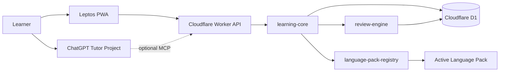

# 01 — Architecture

Scope: system context, trust boundaries, binding architecture decisions, subsystem boundaries.
Depends on: [00-overview.md](00-overview.md).

## 1. System context



One deployable application. Subsystems (review-engine, tutor orchestration, analytics, pack registry, persistence, offline sync) are code-ownership and dependency boundaries, not services or deployments.

## 2. Trust boundaries

| # | Boundary | Rule |
|---|---|---|
| 1 | Browser | Untrusted client. No server secrets in WASM. |
| 2 | Cloudflare | Worker validates identity, authorization, schemas, idempotency, rate limits. |
| 3 | Database | D1 reachable only via Worker bindings and deployment tooling. |
| 4 | Review | Scheduling inputs/outputs validated + versioned. review-engine has no network access, no language behavior. |
| 5 | Plugin | Packs get bounded typed inputs only. No D1, secrets, or network. |
| 6 | ChatGPT | MCP outputs contain minimum learner + active-pack context. |
| 7 | GitHub | Repo holds code, pack assets, schema. Never secrets or DB exports. |

## 3. Architecture decisions

### AD-1 Frontend: Leptos CSR

CSR, not SSR. Private app, no SEO; static assets from Cloudflare; small Worker API stays small; PWA/offline straightforward. Domain model and API stay SSR-migration-compatible.

### AD-2 Backend: `workers-rs` direct

No Axum production server on Workers. Axum permitted in local test utilities only.

### AD-3 Database: one D1 per environment

`lingua-tutor-dev`, `lingua-tutor-prod`. Production data never used as test fixtures.

### AD-4 API style: typed HTTP JSON

Resource endpoints plus command endpoints where they map to domain actions (complete review, apply card mutations). Same service layer serves HTTP and future MCP.

### AD-5 Scheduler: app-owned interface

`ReviewScheduler` trait owned by application ([05-review-engine.md](05-review-engine.md)). FSRS-compatible algorithm preferred; pinned crate is implementation detail. If crate fails Worker compile/size gate: keep trait, ship deterministic fallback scheduler, preserve immutable review data, defer optimization, do not block the app.

### AD-6 MCP: optional layer over service layer

Feature-gated until account availability, OAuth 2.1, transport, write confirmation, mobile behavior, latency validated. Owns no business logic, duplicates no queries. Spec: [13-roadmap.md](13-roadmap.md).

### AD-7 Authentication

| Client | Auth |
|---|---|
| Browser/PWA | Cloudflare Access, owner email only |
| MCP/ChatGPT | OAuth 2.1 authorization code + PKCE (when enabled) |
| CI/CD | scoped Cloudflare API token in GitHub environment secrets |

### AD-8 Interoperability: export only

Versioned JSON + CSV export in v1. No Anki sync in core. Later adapter (if ever) consumes exports; never becomes system of record.

### AD-9 Plugins: compile-time registration, runtime selection

```rust
pub fn built_in_language_packs() -> LanguagePackRegistry {
    LanguagePackRegistry::new([
        language_pack_es_es::register(),
    ])
}
```

No dynamic libraries, remote code, sandboxing, marketplace. Later: signed declarative assets at runtime possible; executable pack behavior stays compiled and reviewed unless a separate security design is approved.

## 4. Data flow invariants

- Card schedule update + review event insert: one transaction (or equivalent atomic op).
- Lesson completion (metrics, evidence, errors, card mutations): atomic, idempotent via client operation ID.
- Every language-specific record carries `language_pack_id` + pack version.
- Historical records never re-normalized on pack change or upgrade.
