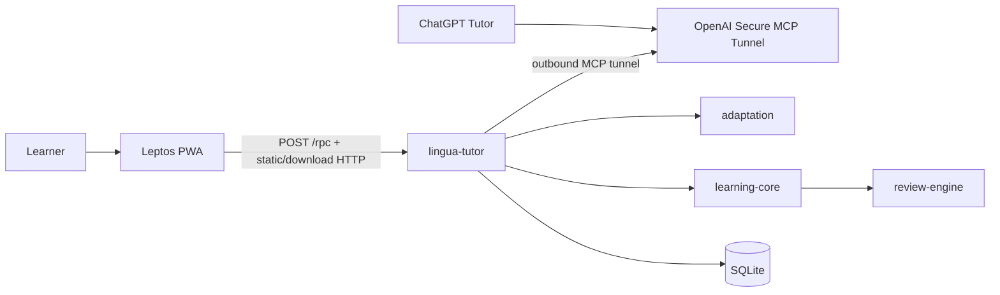

# 01 — Architecture

Scope: active localhost architecture and binding boundaries.

## 1. System context

One local application owns the PWA assets, browser JSON-RPC boundary, in-process MCP dispatch, secure tunnel transport, methodology processing, and SQLite access. Target-language behavior is not compiled into the runtime.

## 2. Trust boundaries

| # | Boundary | Rule |
|---|---|---|
| 1 | Browser | UI talks only to loopback HTTP. No secrets in WASM. |
| 2 | Local runtime | Validates schemas, idempotency, limits, profile ownership and all writes. |
| 3 | Database | One local SQLite database; only the local runtime opens it for application traffic. |
| 4 | Review/adaptation | Deterministic processing has no network or language-specific behavior. |
| 5 | Tutor | Linguistic interpretation arrives only through the bounded tutor contract; tutor cannot write persistence directly. |
| 6 | ChatGPT transport | Access is only through the in-process secure MCP tunnel; tunnel credentials are session-only and never persisted. |
| 7 | Repository | Code and schema only; never runtime secrets or database copies. |

## 3. Binding decisions

- Frontend: Leptos CSR PWA served by the local runtime.
- Runtime: native Rust executable; loopback HTTP serves static assets, `POST /rpc`, and explicit file downloads only.
- Persistence: one SQLite database with WAL and foreign keys enabled.
- PWA operations: JSON-RPC 2.0 over `POST /rpc`; no REST resource layer for application commands/queries.
- MCP: one in-process tool dispatcher calling the same operations directly; no secondary MCP server, synthetic HTTP, or stdio transport.
- Remote reachability: outbound OpenAI Secure MCP Tunnel protocol adapted from Rivet; no public MCP listener, tunnel-client, cloudflared, or child MCP process.
- Language behavior: tutor semantic reasoning plus scalar language-profile metadata; no registry, executable pack, virtual language dispatch or dynamic plugin loader.
- Interoperability: versioned JSON/CSV export; no second system of record.

## 4. Data-flow invariants

- Card schedule update + review event insert are atomic.
- Lesson completion and card mutations are atomic and idempotent.
- Language-specific interpretation is never inferred by core from concrete-language heuristics.
