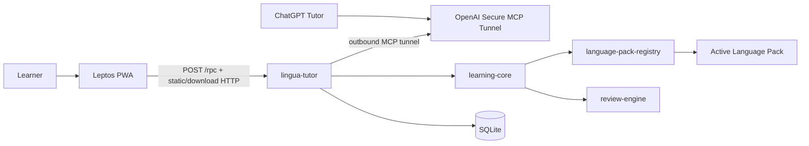

# 01 — Architecture

Scope: active localhost architecture and binding boundaries.

## 1. System context

One local application owns the PWA assets, browser JSON-RPC boundary, in-process MCP dispatch, OpenAI Secure MCP Tunnel transport, and SQLite access.
The application has no remote application server, remote database, authentication service, or deployment environment.

## 2. Trust boundaries

| # | Boundary | Rule |
|---|---|---|
| 1 | Browser | UI talks only to loopback HTTP. No secrets in WASM. |
| 2 | Local runtime | Validates schemas, idempotency, limits, and all writes. |
| 3 | Database | One local SQLite database; only the local runtime opens it for application traffic. |
| 4 | Review | review-engine has no network or language behavior. |
| 5 | Plugin | Language packs receive bounded typed inputs; no storage or network access. |
| 6 | ChatGPT | Access uses the in-process OpenAI Secure MCP Tunnel. Tunnel credentials exist only for the process lifetime and are not persisted. |
| 7 | Repository | Code and schema only; never runtime secrets or database copies. |

## 3. Binding decisions

- Frontend: Leptos CSR PWA served by the local runtime.
- Runtime: native Rust executable; loopback HTTP serves static assets, `POST /rpc`, and explicit file downloads only.
- Persistence: one SQLite database with WAL and foreign keys enabled.
- PWA operations: JSON-RPC 2.0 over `POST /rpc`; no REST resource layer for application commands/queries.
- MCP: one in-process tool dispatcher calling the same handlers directly; no secondary MCP server, synthetic HTTP, or stdio transport.
- Remote reachability: outbound OpenAI Secure MCP Tunnel protocol adapted from Rivet; no public MCP listener, tunnel-client, cloudflared, or child MCP process.
- Plugins: compile-time registration, runtime selection.
- Interoperability: versioned JSON/CSV export; no second system of record.

## 4. Data-flow invariants

- Card schedule update + review event insert are atomic.
- Lesson completion and card mutations are atomic and idempotent.
- Every language-specific record carries language-pack identity/version where required.
- Historical records are not silently re-normalized after pack upgrades.
