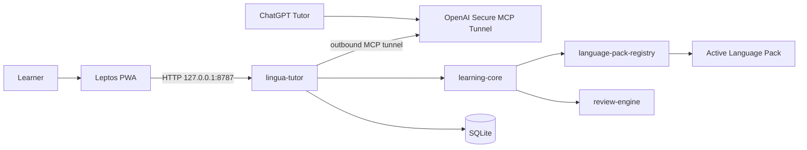

# 01 — Architecture

Scope: active localhost architecture and binding boundaries.

## 1. System context

One local application owns the HTTP API, PWA assets, in-process MCP dispatch, secure tunnel transport, and SQLite access. There is no application server, database, authentication service, or deployment environment outside the machine.

## 2. Trust boundaries

| # | Boundary | Rule |
|---|---|---|
| 1 | Browser | UI talks only to loopback HTTP. No secrets in WASM. |
| 2 | Local runtime | Validates schemas, idempotency, limits, and all writes. |
| 3 | Database | One local SQLite database; only the local runtime opens it for application traffic. |
| 4 | Review | review-engine has no network or language behavior. |
| 5 | Plugin | Language packs receive bounded typed inputs; no storage or network access. |
| 6 | ChatGPT | Access is only through the in-process secure MCP tunnel; tunnel credentials are session-only and never persisted. |
| 7 | Repository | Code and schema only; never runtime secrets or database copies. |

## 3. Binding decisions

- Frontend: Leptos CSR PWA served by the local runtime.
- Runtime: native Rust executable, loopback HTTP only.
- Persistence: one SQLite database with WAL and foreign keys enabled.
- MCP: one in-process JSON-RPC dispatcher shared by the built-in secure tunnel and application logic; no secondary MCP server or stdio transport.
- Remote reachability: outbound OpenAI Secure MCP Tunnel protocol adapted from Rivet; no public MCP listener, tunnel-client, cloudflared, or child MCP process.
- Plugins: compile-time registration, runtime selection.
- Interoperability: versioned JSON/CSV export; no second system of record.

## 4. Data-flow invariants

- Card schedule update + review event insert are atomic.
- Lesson completion and card mutations are atomic and idempotent.
- Every language-specific record carries language-pack identity/version where required.
- Historical records are not silently re-normalized after pack upgrades.
